

  

<picture><source media="(prefers-color-scheme: dark)" srcset="assets/readme/header-banner-dark.png"></picture>

  

---

# <picture><source media="(prefers-color-scheme: dark)" srcset="assets/readme/contributing/c001-dark.webp"></picture>

<picture><source media="(prefers-color-scheme: dark)" srcset="assets/readme/contributing/c002-dark.webp"></picture>

> - <picture><source media="(prefers-color-scheme: dark)" srcset="assets/readme/contributing/c003-dark.webp"></picture> <a href="CONTRIBUTING.src.md"><picture><source media="(prefers-color-scheme: dark)" srcset="assets/readme/contributing/c004-dark.webp"></picture></a> <picture><source media="(prefers-color-scheme: dark)" srcset="assets/readme/contributing/c005-dark.webp"></picture>
> - <picture><source media="(prefers-color-scheme: dark)" srcset="assets/readme/contributing/c006-dark.webp"></picture>

## <picture><source media="(prefers-color-scheme: dark)" srcset="assets/readme/contributing/c007-dark.webp"></picture>

<picture><source media="(prefers-color-scheme: dark)" srcset="assets/readme/contributing/c008-dark.webp"></picture>

## <picture><source media="(prefers-color-scheme: dark)" srcset="assets/readme/contributing/c009-dark.webp"></picture>

<picture><source media="(prefers-color-scheme: dark)" srcset="assets/readme/contributing/c010-dark.webp"></picture>

- <picture><source media="(prefers-color-scheme: dark)" srcset="assets/readme/contributing/c011-dark.webp"></picture>
- <picture><source media="(prefers-color-scheme: dark)" srcset="assets/readme/contributing/c012-dark.webp"></picture>
- <picture><source media="(prefers-color-scheme: dark)" srcset="assets/readme/contributing/c013-dark.webp"></picture>
- <picture><source media="(prefers-color-scheme: dark)" srcset="assets/readme/contributing/c014-dark.webp"></picture>
- <picture><source media="(prefers-color-scheme: dark)" srcset="assets/readme/contributing/c015-dark.webp">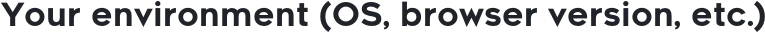</picture>

## <picture><source media="(prefers-color-scheme: dark)" srcset="assets/readme/contributing/c016-dark.webp"></picture>

<picture><source media="(prefers-color-scheme: dark)" srcset="assets/readme/contributing/c017-dark.webp"></picture>

- <picture><source media="(prefers-color-scheme: dark)" srcset="assets/readme/contributing/c018-dark.webp"></picture>
- <picture><source media="(prefers-color-scheme: dark)" srcset="assets/readme/contributing/c019-dark.webp"></picture>
- <picture><source media="(prefers-color-scheme: dark)" srcset="assets/readme/contributing/c020-dark.webp"></picture>
- <picture><source media="(prefers-color-scheme: dark)" srcset="assets/readme/contributing/c021-dark.webp"></picture>

## <picture><source media="(prefers-color-scheme: dark)" srcset="assets/readme/contributing/c022-dark.webp"></picture>

1. <picture><source media="(prefers-color-scheme: dark)" srcset="assets/readme/contributing/c023-dark.webp">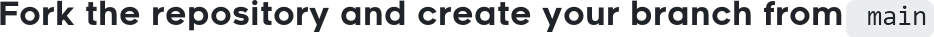</picture>
2. <picture><source media="(prefers-color-scheme: dark)" srcset="assets/readme/contributing/c024-dark.webp"></picture>
3. <picture><source media="(prefers-color-scheme: dark)" srcset="assets/readme/contributing/c025-dark.webp"></picture>
4. <picture><source media="(prefers-color-scheme: dark)" srcset="assets/readme/contributing/c026-dark.webp">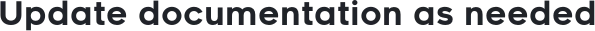</picture>
5. <picture><source media="(prefers-color-scheme: dark)" srcset="assets/readme/contributing/c027-dark.webp"></picture>
6. <picture><source media="(prefers-color-scheme: dark)" srcset="assets/readme/contributing/c028-dark.webp"></picture>

### <picture><source media="(prefers-color-scheme: dark)" srcset="assets/readme/contributing/c029-dark.webp"></picture>

<table>
<tr><th align="left"><picture><source media="(prefers-color-scheme: dark)" srcset="assets/readme/contributing/c030-dark.webp">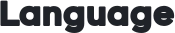</picture></th><th align="left"><picture><source media="(prefers-color-scheme: dark)" srcset="assets/readme/contributing/c031-dark.webp"></picture></th></tr>
<tr><td align="left"><picture><source media="(prefers-color-scheme: dark)" srcset="assets/readme/contributing/c032-dark.webp"></picture></td><td align="left"><picture><source media="(prefers-color-scheme: dark)" srcset="assets/readme/contributing/c033-dark.webp"></picture></td></tr>
<tr><td align="left"><picture><source media="(prefers-color-scheme: dark)" srcset="assets/readme/contributing/c034-dark.webp"></picture></td><td align="left"><picture><source media="(prefers-color-scheme: dark)" srcset="assets/readme/contributing/c035-dark.webp"></picture></td></tr>
<tr><td align="left"><picture><source media="(prefers-color-scheme: dark)" srcset="assets/readme/contributing/c036-dark.webp"></picture></td><td align="left"><picture><source media="(prefers-color-scheme: dark)" srcset="assets/readme/contributing/c037-dark.webp"></picture></td></tr>
<tr><td align="left"><picture><source media="(prefers-color-scheme: dark)" srcset="assets/readme/contributing/c038-dark.webp"></picture></td><td align="left"><picture><source media="(prefers-color-scheme: dark)" srcset="assets/readme/contributing/c039-dark.webp">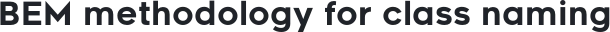</picture></td></tr>
</table>

<picture><source media="(prefers-color-scheme: dark)" srcset="assets/readme/contributing/c040-dark.webp">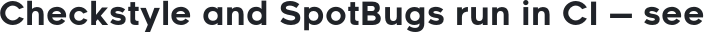</picture> <a href="README.md"><picture><source media="(prefers-color-scheme: dark)" srcset="assets/readme/contributing/c041-dark.webp"></picture></a> <picture><source media="(prefers-color-scheme: dark)" srcset="assets/readme/contributing/c042-dark.webp"></picture>

### <picture><source media="(prefers-color-scheme: dark)" srcset="assets/readme/contributing/c043-dark.webp"></picture>

<picture><source media="(prefers-color-scheme: dark)" srcset="assets/readme/contributing/c044-dark.webp">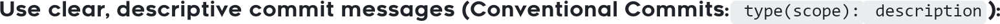</picture>

- <picture><source media="(prefers-color-scheme: dark)" srcset="assets/readme/contributing/c045-dark.webp"></picture>
- <picture><source media="(prefers-color-scheme: dark)" srcset="assets/readme/contributing/c046-dark.webp">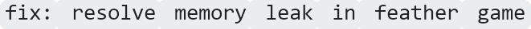</picture>
- <picture><source media="(prefers-color-scheme: dark)" srcset="assets/readme/contributing/c047-dark.webp">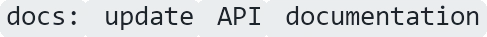</picture>
- <picture><source media="(prefers-color-scheme: dark)" srcset="assets/readme/contributing/c048-dark.webp">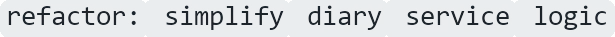</picture>
- <picture><source media="(prefers-color-scheme: dark)" srcset="assets/readme/contributing/c049-dark.webp"></picture>

## <picture><source media="(prefers-color-scheme: dark)" srcset="assets/readme/contributing/c050-dark.webp"></picture>

### <picture><source media="(prefers-color-scheme: dark)" srcset="assets/readme/contributing/c051-dark.webp"></picture>

- <picture><source media="(prefers-color-scheme: dark)" srcset="assets/readme/contributing/c052-dark.webp"></picture>
- <picture><source media="(prefers-color-scheme: dark)" srcset="assets/readme/contributing/c053-dark.webp"></picture>
- <picture><source media="(prefers-color-scheme: dark)" srcset="assets/readme/contributing/c054-dark.webp"></picture>
- <picture><source media="(prefers-color-scheme: dark)" srcset="assets/readme/contributing/c055-dark.webp"></picture>

### <picture><source media="(prefers-color-scheme: dark)" srcset="assets/readme/contributing/c056-dark.webp"></picture>

1. <picture><source media="(prefers-color-scheme: dark)" srcset="assets/readme/contributing/c057-dark.webp">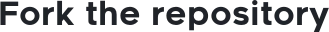</picture>
2. <picture><source media="(prefers-color-scheme: dark)" srcset="assets/readme/contributing/c058-dark.webp">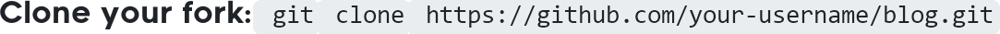</picture>
3. <picture><source media="(prefers-color-scheme: dark)" srcset="assets/readme/contributing/c059-dark.webp"></picture>
4. <picture><source media="(prefers-color-scheme: dark)" srcset="assets/readme/contributing/c060-dark.webp"></picture>
5. <picture><source media="(prefers-color-scheme: dark)" srcset="assets/readme/contributing/c061-dark.webp"></picture>
6. <picture><source media="(prefers-color-scheme: dark)" srcset="assets/readme/contributing/c062-dark.webp"></picture>
7. <picture><source media="(prefers-color-scheme: dark)" srcset="assets/readme/contributing/c063-dark.webp"></picture>

<picture><source media="(prefers-color-scheme: dark)" srcset="assets/readme/contributing/c064-dark.webp"></picture> <a href="README.md"><picture><source media="(prefers-color-scheme: dark)" srcset="assets/readme/contributing/c065-dark.webp"></picture></a>

## <picture><source media="(prefers-color-scheme: dark)" srcset="assets/readme/contributing/c066-dark.webp"></picture>

<picture><source media="(prefers-color-scheme: dark)" srcset="assets/readme/contributing/c067-dark.webp"></picture> <a href="docs/LICENSE.md"><picture><source media="(prefers-color-scheme: dark)" srcset="assets/readme/contributing/c068-dark.webp"></picture></a> <picture><source media="(prefers-color-scheme: dark)" srcset="assets/readme/contributing/c069-dark.webp">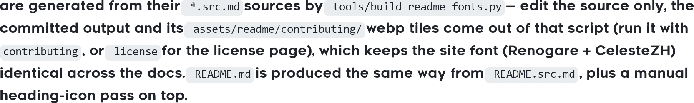</picture>

## <picture><source media="(prefers-color-scheme: dark)" srcset="assets/readme/contributing/c070-dark.webp"></picture>

<picture><source media="(prefers-color-scheme: dark)" srcset="assets/readme/contributing/c071-dark.webp">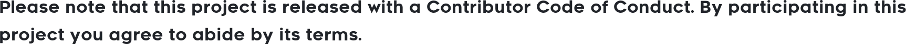</picture>

## <picture><source media="(prefers-color-scheme: dark)" srcset="assets/readme/contributing/c072-dark.webp"></picture>

<picture><source media="(prefers-color-scheme: dark)" srcset="assets/readme/contributing/c073-dark.webp"></picture>

1. <picture><source media="(prefers-color-scheme: dark)" srcset="assets/readme/contributing/c074-dark.webp"></picture>
2. <picture><source media="(prefers-color-scheme: dark)" srcset="assets/readme/contributing/c075-dark.webp"></picture>
3. <picture><source media="(prefers-color-scheme: dark)" srcset="assets/readme/contributing/c076-dark.webp"></picture>

---

