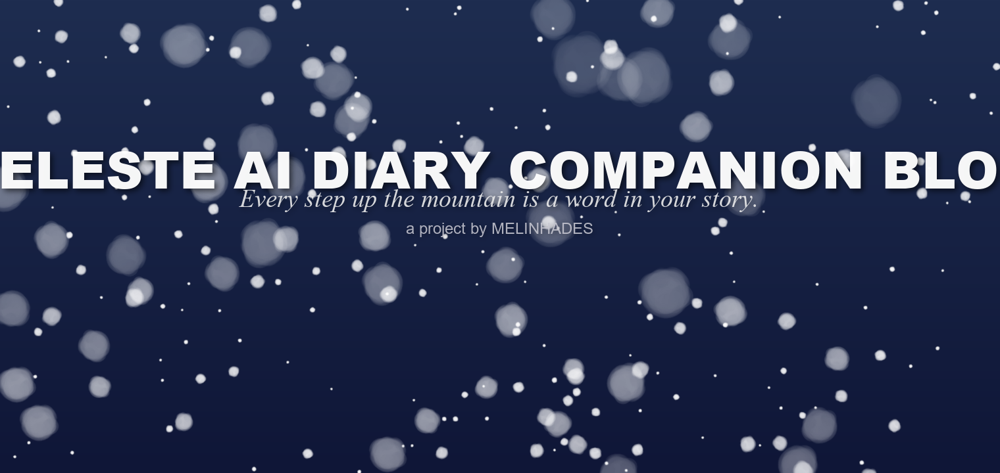
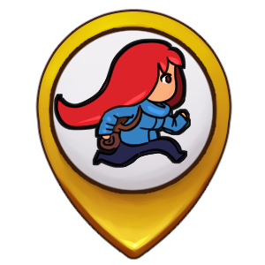
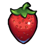
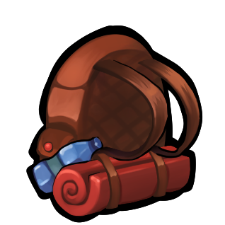
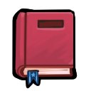
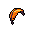

  

<picture><source media="(prefers-color-scheme: dark)" srcset="assets/readme/header-banner-dark.png"></picture>

  

---

#  Contribution Guidelines

Thank you for considering contributing to the Celeste AI Diary Companion Blog! We appreciate your help in making this project better.

> - Source of this page: [CONTRIBUTING.src.md](CONTRIBUTING.src.md) — edit the source, then run `python tools/build_readme_fonts.py contributing`
> - Rendered text here is baked into Renogare + CelesteZH images (GitHub strips custom fonts), so it isn't selectable; the rules themselves are unchanged

##  How We Work

We use GitHub for tracking issues and pull requests. All contributions should be made through pull requests.

##  Reporting Bugs

Before submitting a bug report, please check if it has already been reported. When you create a bug report, include:

- A clear and descriptive title
- Steps to reproduce the issue
- Expected behavior vs. actual behavior
- Screenshots if applicable
- Your environment (OS, browser version, etc.)

##  Suggesting Features

Feature requests are welcome! Please provide:

- A clear description of the feature
- Why it would be useful to users
- Any potential implementation considerations
- Mockups or examples if available

##  Pull Request Process

1. Fork the repository and create your branch from `main`
2. If you've added code that should be tested, add tests
3. Ensure your code follows our style guidelines
4. Update documentation as needed
5. Make sure your code lints and passes any existing tests
6. Issue that pull request!

### Code Style

| Language | Convention |
|----------|------------|
| Java | Google Java Style Guide, with exceptions noted in the code |
| JavaScript | StandardJS with project-specific overrides |
| HTML | HTML5 semantic conventions |
| CSS | BEM methodology for class naming |

Checkstyle and SpotBugs run in CI — see [Code Quality Gates](README.md); keep both clean.

### Commit Messages

Use clear, descriptive commit messages (Conventional Commits: `type(scope): description`):

- `feat: add new diary export feature`
- `fix: resolve memory leak in feather game`
- `docs: update API documentation`
- `refactor: simplify diary service logic`
- `test: add unit tests for emotion detection`

##  Getting Started

### Prerequisites

- Java 17+
- Maven 3.6+
- MySQL 5.7+
- Git

### Setup

1. Fork the repository
2. Clone your fork: `git clone https://github.com/your-username/blog.git`
3. Create a branch: `git checkout -b feature/your-feature-name`
4. Make your changes
5. Test your changes thoroughly
6. Commit and push: `git push origin feature/your-feature-name`
7. Open a pull request

Full local setup (database, env vars, Docker) is covered in [Quick Start](README.md).

##  Documentation Assets

This page and [docs/LICENSE.md](docs/LICENSE.md) are generated from their `*.src.md` sources by
`tools/build_readme_fonts.py` — edit the source only, the committed output and its
`assets/readme/contributing/` webp tiles come out of that script (run it with `contributing`, or
`license` for the license page), which keeps the site font (Renogare + CelesteZH) identical across
the docs. `README.md` is produced the same way from `README.src.md`, plus a manual heading-icon
pass on top.

##  Community

Please note that this project is released with a Contributor Code of Conduct. By participating in this project you agree to abide by its terms.

##  Getting Help

If you need help, please:

1. Check the documentation
2. Search existing issues
3. Ask in the project discussions

---

