<div align="center">

<br><br><br>


<br><br><br><br><br><br>

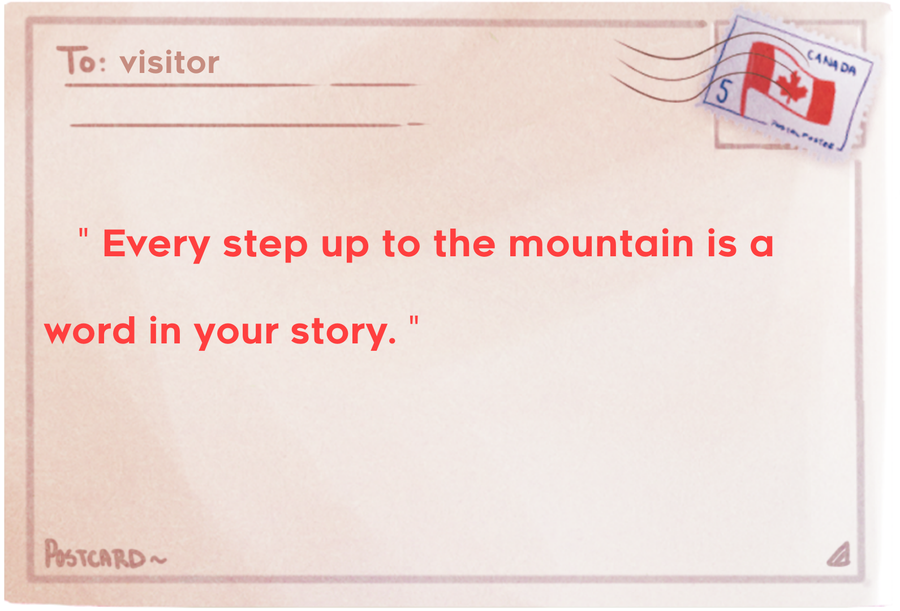

<br><br><br><br><br><br>

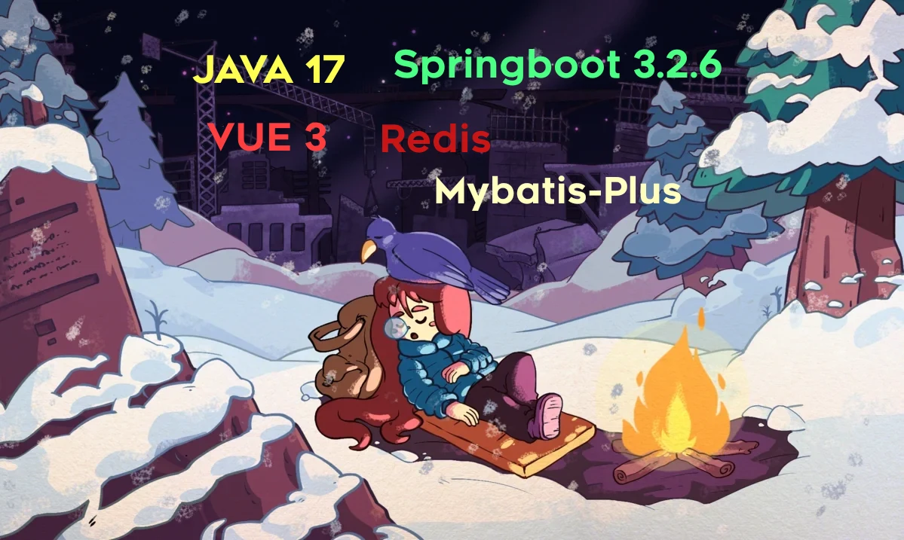
</div>

---

<a name="quick-links"></a>

## 🌐 <picture><source media="(prefers-color-scheme: dark)" srcset="assets/readme/t003-dark.webp"></picture>

<table>
<tr><th align="center"><picture><source media="(prefers-color-scheme: dark)" srcset="assets/readme/t004-dark.webp"></picture></th><th align="center"><picture><source media="(prefers-color-scheme: dark)" srcset="assets/readme/t005-dark.webp"></picture></th><th align="center"><picture><source media="(prefers-color-scheme: dark)" srcset="assets/readme/t006-dark.webp"></picture></th></tr>
<tr><td align="center"><a href="https://instapix.icu"><picture><source media="(prefers-color-scheme: dark)" srcset="assets/readme/t007-dark.webp"></picture></a></td><td align="center"><a href="https://www.bilibili.com/video/BV13QYT64EDX/"><picture><source media="(prefers-color-scheme: dark)" srcset="assets/readme/t008-dark.webp"></picture></a></td><td align="center"><a href="CONTRIBUTING.md"><picture><source media="(prefers-color-scheme: dark)" srcset="assets/readme/t009-dark.webp"></picture></a> <picture><source media="(prefers-color-scheme: dark)" srcset="assets/readme/t010-dark.webp"></picture> <a href="TROUBLESHOOTING.md"><picture><source media="(prefers-color-scheme: dark)" srcset="assets/readme/t011-dark.webp"></picture></a></td></tr>
</table>

> <picture><source media="(prefers-color-scheme: dark)" srcset="assets/readme/t012-dark.webp"></picture>

---

<a name="table-of-contents"></a>

## 📖 <picture><source media="(prefers-color-scheme: dark)" srcset="assets/readme/t013-dark.webp"></picture>

- <a href="#the-vision"><picture><source media="(prefers-color-scheme: dark)" srcset="assets/readme/t014-dark.webp"></picture></a>
- <a href="#core-features"><picture><source media="(prefers-color-scheme: dark)" srcset="assets/readme/t015-dark.webp"></picture></a>
- <a href="#screenshots-gallery"><picture><source media="(prefers-color-scheme: dark)" srcset="assets/readme/t016-dark.webp"></picture></a>
- <a href="#golden-feather-system"><picture><source media="(prefers-color-scheme: dark)" srcset="assets/readme/t017-dark.webp"></picture></a>
- <a href="#dream-mirror-badeline"><picture><source media="(prefers-color-scheme: dark)" srcset="assets/readme/t018-dark.webp"></picture></a>
- <a href="#system-architecture"><picture><source media="(prefers-color-scheme: dark)" srcset="assets/readme/t019-dark.webp"></picture></a>
- <a href="#project-structure"><picture><source media="(prefers-color-scheme: dark)" srcset="assets/readme/t020-dark.webp"></picture></a>
- <a href="#quick-start"><picture><source media="(prefers-color-scheme: dark)" srcset="assets/readme/t021-dark.webp"></picture></a>
- <a href="#configuration-deep-dive"><picture><source media="(prefers-color-scheme: dark)" srcset="assets/readme/t022-dark.webp"></picture></a>
- <a href="#core-features-explained"><picture><source media="(prefers-color-scheme: dark)" srcset="assets/readme/t023-dark.webp"></picture></a>
- <a href="#technical-deep-dive"><picture><source media="(prefers-color-scheme: dark)" srcset="assets/readme/t024-dark.webp"></picture></a>
- <a href="#testing-quality"><picture><source media="(prefers-color-scheme: dark)" srcset="assets/readme/t025-dark.webp"></picture></a>
- <a href="#deployment-guide"><picture><source media="(prefers-color-scheme: dark)" srcset="assets/readme/t026-dark.webp"></picture></a>
- <a href="#contribution-guide"><picture><source media="(prefers-color-scheme: dark)" srcset="assets/readme/t027-dark.webp"></picture></a>
- <a href="#faq-troubleshooting"><picture><source media="(prefers-color-scheme: dark)" srcset="assets/readme/t028-dark.webp"></picture></a>
- <a href="#roadmap"><picture><source media="(prefers-color-scheme: dark)" srcset="assets/readme/t029-dark.webp"></picture></a>
- <a href="#license-acknowledgments"><picture><source media="(prefers-color-scheme: dark)" srcset="assets/readme/t030-dark.webp"></picture></a>

---

<a name="the-vision"></a>

## 💫 <picture><source media="(prefers-color-scheme: dark)" srcset="assets/readme/t031-dark.webp"></picture>

> <picture><source media="(prefers-color-scheme: dark)" srcset="assets/readme/t032-dark.webp"></picture>

<picture><source media="(prefers-color-scheme: dark)" srcset="assets/readme/t033-dark.webp"></picture>

<picture><source media="(prefers-color-scheme: dark)" srcset="assets/readme/t034-dark.webp">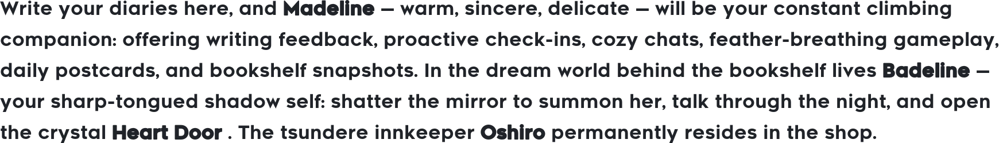</picture>

<picture><source media="(prefers-color-scheme: dark)" srcset="assets/readme/t035-dark.webp"></picture>

> <picture><source media="(prefers-color-scheme: dark)" srcset="assets/readme/t036-dark.webp"></picture>

---

<a name="core-features"></a>

## ✨ <picture><source media="(prefers-color-scheme: dark)" srcset="assets/readme/t037-dark.webp"></picture>

<table>
<tr><th align="center"><picture><source media="(prefers-color-scheme: dark)" srcset="assets/readme/t038-dark.webp"></picture></th><th align="left"><picture><source media="(prefers-color-scheme: dark)" srcset="assets/readme/t039-dark.webp"></picture></th><th align="left"><picture><source media="(prefers-color-scheme: dark)" srcset="assets/readme/t040-dark.webp"></picture></th><th align="center"><picture><source media="(prefers-color-scheme: dark)" srcset="assets/readme/t041-dark.webp"></picture></th></tr>
<tr><td align="center"><picture><source media="(prefers-color-scheme: dark)" srcset="assets/readme/t042-dark.webp"></picture></td><td align="left"><picture><source media="(prefers-color-scheme: dark)" srcset="assets/readme/t043-dark.webp"></picture></td><td align="left"><picture><source media="(prefers-color-scheme: dark)" srcset="assets/readme/t044-dark.webp"></picture></td><td align="center"><picture><source media="(prefers-color-scheme: dark)" srcset="assets/readme/t045-dark.webp"></picture></td></tr>
<tr><td align="center"></td><td align="left"><picture><source media="(prefers-color-scheme: dark)" srcset="assets/readme/t046-dark.webp"></picture></td><td align="left"><picture><source media="(prefers-color-scheme: dark)" srcset="assets/readme/t047-dark.webp"></picture></td><td align="center"><picture><source media="(prefers-color-scheme: dark)" srcset="assets/readme/t048-dark.webp"></picture></td></tr>
<tr><td align="center">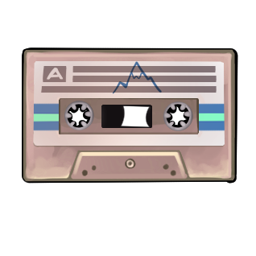</td><td align="left"><picture><source media="(prefers-color-scheme: dark)" srcset="assets/readme/t049-dark.webp"></picture></td><td align="left"><picture><source media="(prefers-color-scheme: dark)" srcset="assets/readme/t050-dark.webp"></picture></td><td align="center"><picture><source media="(prefers-color-scheme: dark)" srcset="assets/readme/t051-dark.webp"></picture></td></tr>
<tr><td align="center"></td><td align="left"><picture><source media="(prefers-color-scheme: dark)" srcset="assets/readme/t052-dark.webp"></picture></td><td align="left"><picture><source media="(prefers-color-scheme: dark)" srcset="assets/readme/t053-dark.webp"></picture></td><td align="center"><picture><source media="(prefers-color-scheme: dark)" srcset="assets/readme/t054-dark.webp"></picture></td></tr>
<tr><td align="center"></td><td align="left"><picture><source media="(prefers-color-scheme: dark)" srcset="assets/readme/t055-dark.webp"></picture></td><td align="left"><picture><source media="(prefers-color-scheme: dark)" srcset="assets/readme/t056-dark.webp"></picture></td><td align="center"><picture><source media="(prefers-color-scheme: dark)" srcset="assets/readme/t057-dark.webp"></picture></td></tr>
<tr><td align="center"><picture><source media="(prefers-color-scheme: dark)" srcset="assets/readme/t058-dark.webp"></picture></td><td align="left"><picture><source media="(prefers-color-scheme: dark)" srcset="assets/readme/t059-dark.webp"></picture></td><td align="left"><picture><source media="(prefers-color-scheme: dark)" srcset="assets/readme/t060-dark.webp"></picture></td><td align="center"><picture><source media="(prefers-color-scheme: dark)" srcset="assets/readme/t061-dark.webp"></picture></td></tr>
<tr><td align="center"><picture><source media="(prefers-color-scheme: dark)" srcset="assets/readme/t062-dark.webp"></picture></td><td align="left"><picture><source media="(prefers-color-scheme: dark)" srcset="assets/readme/t063-dark.webp"></picture></td><td align="left"><picture><source media="(prefers-color-scheme: dark)" srcset="assets/readme/t064-dark.webp"></picture></td><td align="center"><picture><source media="(prefers-color-scheme: dark)" srcset="assets/readme/t065-dark.webp"></picture></td></tr>
<tr><td align="center"><picture><source media="(prefers-color-scheme: dark)" srcset="assets/readme/t066-dark.webp"></picture></td><td align="left"><picture><source media="(prefers-color-scheme: dark)" srcset="assets/readme/t067-dark.webp"></picture></td><td align="left"><picture><source media="(prefers-color-scheme: dark)" srcset="assets/readme/t068-dark.webp"></picture></td><td align="center"><picture><source media="(prefers-color-scheme: dark)" srcset="assets/readme/t069-dark.webp"></picture></td></tr>
<tr><td align="center"><picture><source media="(prefers-color-scheme: dark)" srcset="assets/readme/t070-dark.webp"></picture></td><td align="left"><picture><source media="(prefers-color-scheme: dark)" srcset="assets/readme/t071-dark.webp"></picture></td><td align="left"><picture><source media="(prefers-color-scheme: dark)" srcset="assets/readme/t072-dark.webp"></picture></td><td align="center"><picture><source media="(prefers-color-scheme: dark)" srcset="assets/readme/t073-dark.webp"></picture></td></tr>
<tr><td align="center"><picture><source media="(prefers-color-scheme: dark)" srcset="assets/readme/t074-dark.webp"></picture></td><td align="left"><picture><source media="(prefers-color-scheme: dark)" srcset="assets/readme/t075-dark.webp"></picture></td><td align="left"><picture><source media="(prefers-color-scheme: dark)" srcset="assets/readme/t076-dark.webp"></picture></td><td align="center"><picture><source media="(prefers-color-scheme: dark)" srcset="assets/readme/t077-dark.webp"></picture></td></tr>
<tr><td align="center"><picture><source media="(prefers-color-scheme: dark)" srcset="assets/readme/t078-dark.webp"></picture></td><td align="left"><picture><source media="(prefers-color-scheme: dark)" srcset="assets/readme/t079-dark.webp"></picture></td><td align="left"><picture><source media="(prefers-color-scheme: dark)" srcset="assets/readme/t080-dark.webp"></picture></td><td align="center"><picture><source media="(prefers-color-scheme: dark)" srcset="assets/readme/t081-dark.webp"></picture></td></tr>
<tr><td align="center"><picture><source media="(prefers-color-scheme: dark)" srcset="assets/readme/t082-dark.webp"></picture></td><td align="left"><picture><source media="(prefers-color-scheme: dark)" srcset="assets/readme/t083-dark.webp"></picture></td><td align="left"><picture><source media="(prefers-color-scheme: dark)" srcset="assets/readme/t084-dark.webp"></picture></td><td align="center"><picture><source media="(prefers-color-scheme: dark)" srcset="assets/readme/t085-dark.webp"></picture></td></tr>
<tr><td align="center"><picture><source media="(prefers-color-scheme: dark)" srcset="assets/readme/t086-dark.webp"></picture></td><td align="left"><picture><source media="(prefers-color-scheme: dark)" srcset="assets/readme/t087-dark.webp"></picture></td><td align="left"><picture><source media="(prefers-color-scheme: dark)" srcset="assets/readme/t088-dark.webp"></picture></td><td align="center"><picture><source media="(prefers-color-scheme: dark)" srcset="assets/readme/t089-dark.webp"></picture></td></tr>
<tr><td align="center"><picture><source media="(prefers-color-scheme: dark)" srcset="assets/readme/t090-dark.webp"></picture></td><td align="left"><picture><source media="(prefers-color-scheme: dark)" srcset="assets/readme/t091-dark.webp"></picture></td><td align="left"><picture><source media="(prefers-color-scheme: dark)" srcset="assets/readme/t092-dark.webp"></picture></td><td align="center"><picture><source media="(prefers-color-scheme: dark)" srcset="assets/readme/t093-dark.webp"></picture></td></tr>
<tr><td align="center"><picture><source media="(prefers-color-scheme: dark)" srcset="assets/readme/t094-dark.webp"></picture></td><td align="left"><picture><source media="(prefers-color-scheme: dark)" srcset="assets/readme/t095-dark.webp"></picture></td><td align="left"><picture><source media="(prefers-color-scheme: dark)" srcset="assets/readme/t096-dark.webp"></picture></td><td align="center"><picture><source media="(prefers-color-scheme: dark)" srcset="assets/readme/t097-dark.webp"></picture></td></tr>
<tr><td align="center"><picture><source media="(prefers-color-scheme: dark)" srcset="assets/readme/t098-dark.webp"></picture></td><td align="left"><picture><source media="(prefers-color-scheme: dark)" srcset="assets/readme/t099-dark.webp"></picture></td><td align="left"><picture><source media="(prefers-color-scheme: dark)" srcset="assets/readme/t100-dark.webp"></picture></td><td align="center"><picture><source media="(prefers-color-scheme: dark)" srcset="assets/readme/t101-dark.webp"></picture></td></tr>
<tr><td align="center"><picture><source media="(prefers-color-scheme: dark)" srcset="assets/readme/t102-dark.webp"></picture></td><td align="left"><picture><source media="(prefers-color-scheme: dark)" srcset="assets/readme/t103-dark.webp"></picture></td><td align="left"><picture><source media="(prefers-color-scheme: dark)" srcset="assets/readme/t104-dark.webp"></picture></td><td align="center"><picture><source media="(prefers-color-scheme: dark)" srcset="assets/readme/t105-dark.webp"></picture></td></tr>
<tr><td align="center"><picture><source media="(prefers-color-scheme: dark)" srcset="assets/readme/t106-dark.webp"></picture></td><td align="left"><picture><source media="(prefers-color-scheme: dark)" srcset="assets/readme/t107-dark.webp"></picture></td><td align="left"><picture><source media="(prefers-color-scheme: dark)" srcset="assets/readme/t108-dark.webp"></picture></td><td align="center"><picture><source media="(prefers-color-scheme: dark)" srcset="assets/readme/t109-dark.webp"></picture></td></tr>
<tr><td align="center"><picture><source media="(prefers-color-scheme: dark)" srcset="assets/readme/t110-dark.webp"></picture></td><td align="left"><picture><source media="(prefers-color-scheme: dark)" srcset="assets/readme/t111-dark.webp"></picture></td><td align="left"><picture><source media="(prefers-color-scheme: dark)" srcset="assets/readme/t112-dark.webp">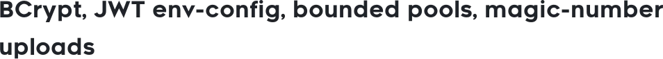</picture></td><td align="center"><picture><source media="(prefers-color-scheme: dark)" srcset="assets/readme/t113-dark.webp"></picture></td></tr>
<tr><td align="center"><picture><source media="(prefers-color-scheme: dark)" srcset="assets/readme/t114-dark.webp"></picture></td><td align="left"><picture><source media="(prefers-color-scheme: dark)" srcset="assets/readme/t115-dark.webp"></picture></td><td align="left"><picture><source media="(prefers-color-scheme: dark)" srcset="assets/readme/t116-dark.webp"></picture></td><td align="center"><picture><source media="(prefers-color-scheme: dark)" srcset="assets/readme/t117-dark.webp"></picture></td></tr>
</table>

---

<a name="screenshots-gallery"></a>

## 🖼️ <picture><source media="(prefers-color-scheme: dark)" srcset="assets/readme/t118-dark.webp"></picture>

### 🔐 <picture><source media="(prefers-color-scheme: dark)" srcset="assets/readme/t119-dark.webp"></picture>

<p align="center">
  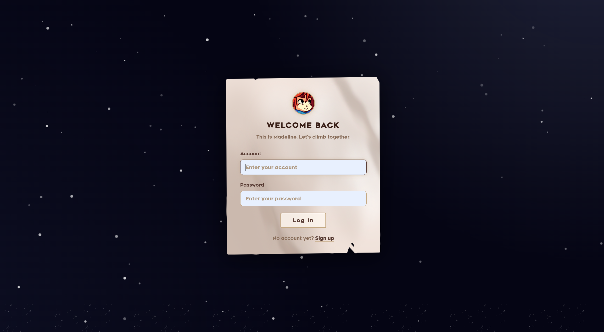
</p>

<picture><source media="(prefers-color-scheme: dark)" srcset="assets/readme/t120-dark.webp"></picture>

### 🏠 <picture><source media="(prefers-color-scheme: dark)" srcset="assets/readme/t121-dark.webp"></picture>

<p align="center">
  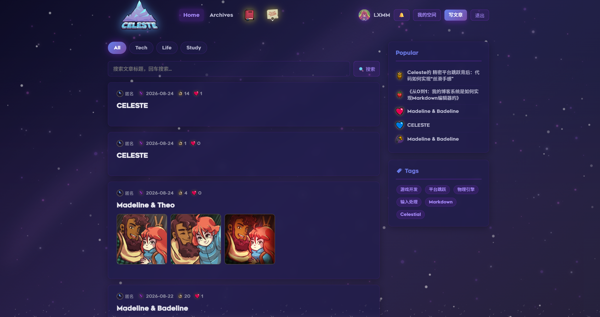
</p>

<picture><source media="(prefers-color-scheme: dark)" srcset="assets/readme/t122-dark.webp"></picture>

### 📖 <picture><source media="(prefers-color-scheme: dark)" srcset="assets/readme/t123-dark.webp"></picture>

<p align="center">
  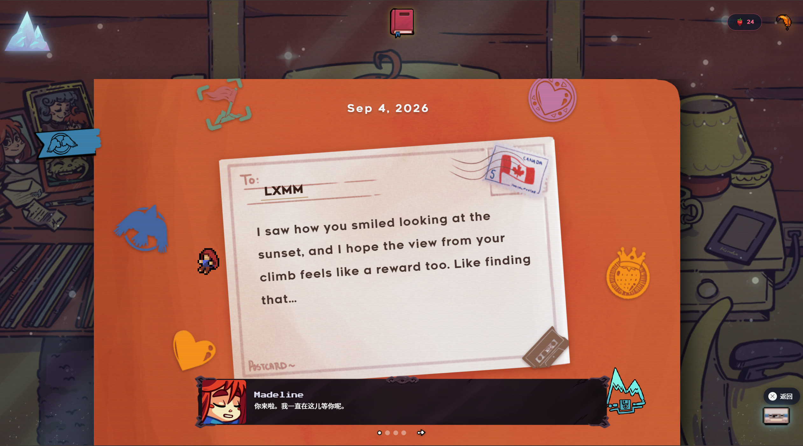
</p>

<picture><source media="(prefers-color-scheme: dark)" srcset="assets/readme/t124-dark.webp"></picture>

### 🌟 <picture><source media="(prefers-color-scheme: dark)" srcset="assets/readme/t125-dark.webp"></picture>

<p align="center">
  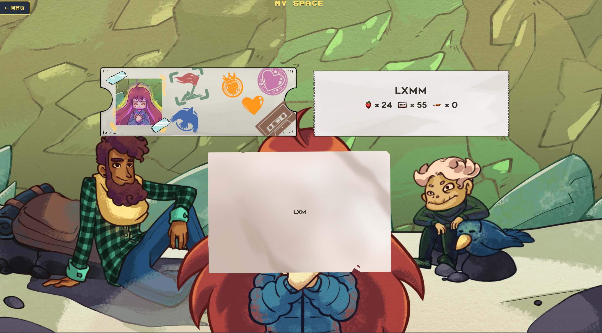
</p>

<picture><source media="(prefers-color-scheme: dark)" srcset="assets/readme/t126-dark.webp"></picture>

### ✍️ <picture><source media="(prefers-color-scheme: dark)" srcset="assets/readme/t127-dark.webp"></picture>

<p align="center">
  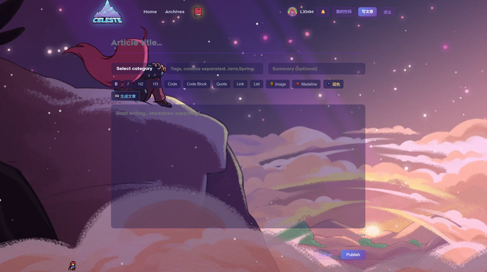
</p>

<picture><source media="(prefers-color-scheme: dark)" srcset="assets/readme/t128-dark.webp"></picture>

### 🏪 <picture><source media="(prefers-color-scheme: dark)" srcset="assets/readme/t129-dark.webp"></picture>

<p align="center">
  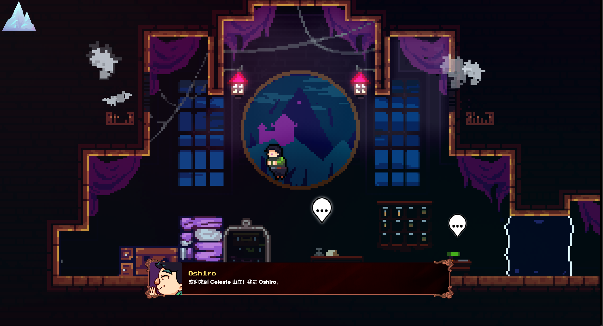
</p>

<picture><source media="(prefers-color-scheme: dark)" srcset="assets/readme/t130-dark.webp"></picture>

### 💻 <picture><source media="(prefers-color-scheme: dark)" srcset="assets/readme/t131-dark.webp"></picture>

<p align="center">
  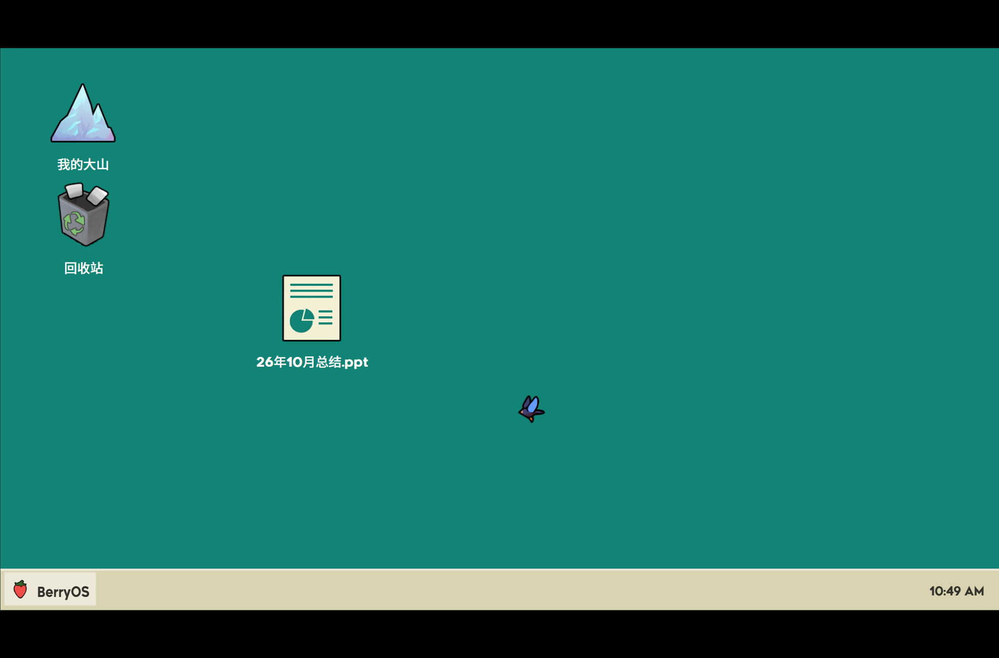
</p>

<picture><source media="(prefers-color-scheme: dark)" srcset="assets/readme/t132-dark.webp"></picture>

### 📊 <picture><source media="(prefers-color-scheme: dark)" srcset="assets/readme/t133-dark.webp"></picture>

<p align="center">
  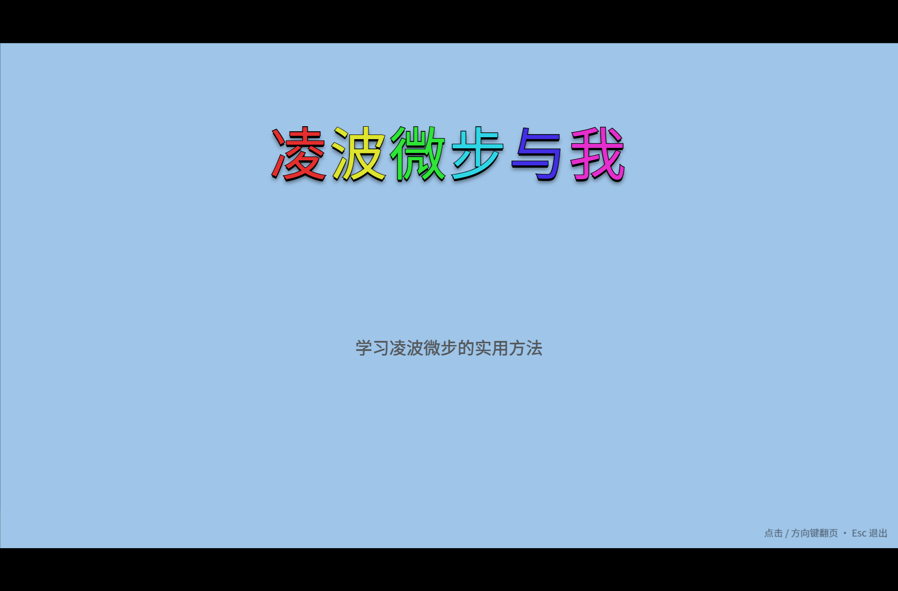
</p>

<picture><source media="(prefers-color-scheme: dark)" srcset="assets/readme/t134-dark.webp"></picture>

### 🌃 <picture><source media="(prefers-color-scheme: dark)" srcset="assets/readme/t135-dark.webp"></picture>

<p align="center">
  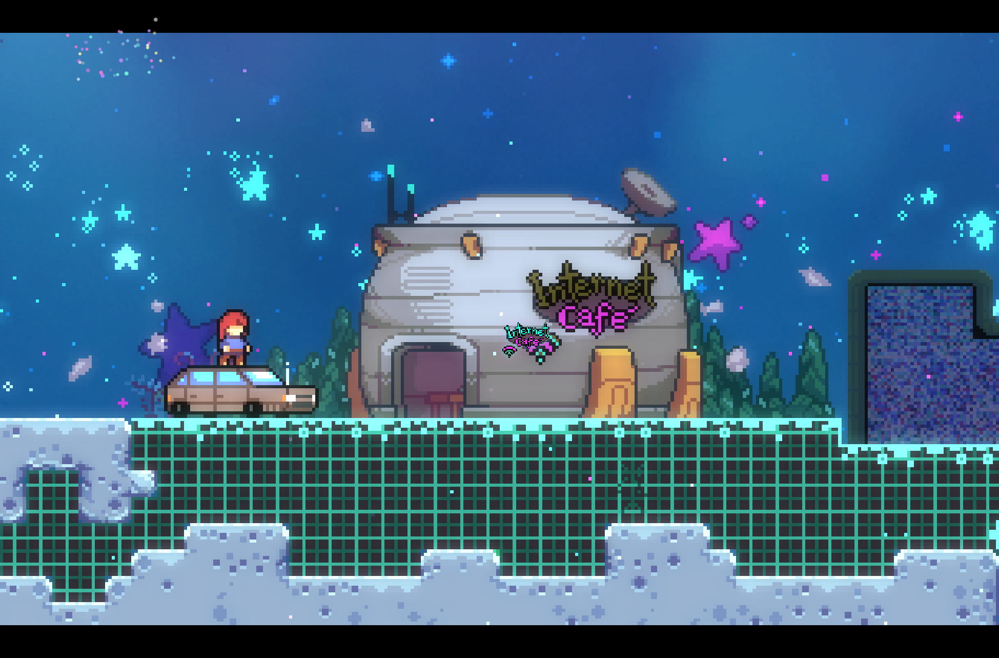
</p>

<picture><source media="(prefers-color-scheme: dark)" srcset="assets/readme/t136-dark.webp"></picture>

### ☎️ <picture><source media="(prefers-color-scheme: dark)" srcset="assets/readme/t137-dark.webp"></picture>

<p align="center">
  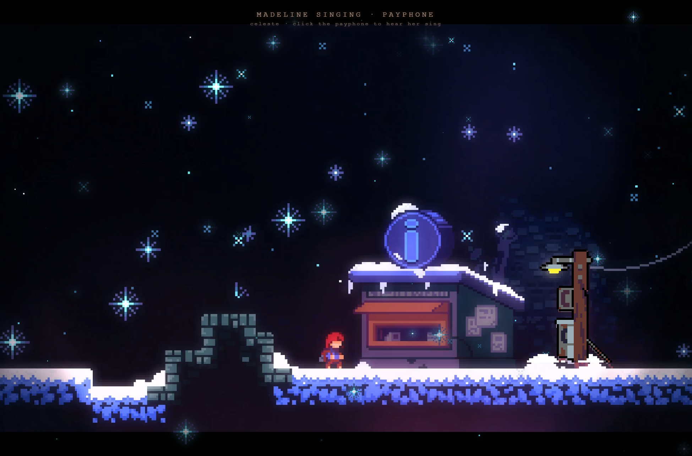
</p>

<picture><source media="(prefers-color-scheme: dark)" srcset="assets/readme/t138-dark.webp"></picture>

### 💬 <picture><source media="(prefers-color-scheme: dark)" srcset="assets/readme/t139-dark.webp"></picture>

<p align="center">
  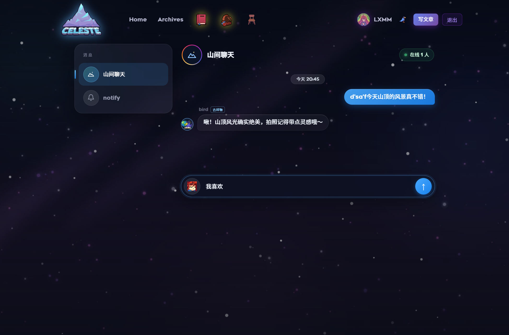
</p>

<picture><source media="(prefers-color-scheme: dark)" srcset="assets/readme/t140-dark.webp"></picture>

### 🐦 <picture><source media="(prefers-color-scheme: dark)" srcset="assets/readme/t141-dark.webp"></picture>

<p align="center">
  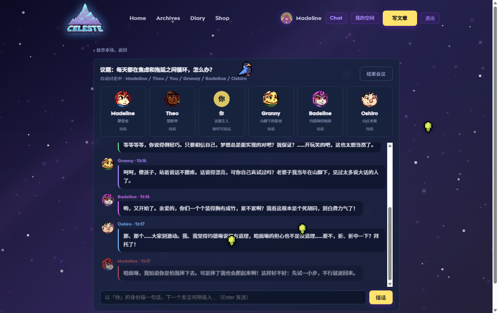
</p>

<picture><source media="(prefers-color-scheme: dark)" srcset="assets/readme/t142-dark.webp"></picture>

<picture><source media="(prefers-color-scheme: dark)" srcset="assets/readme/t143-dark.webp"></picture>

- <picture><source media="(prefers-color-scheme: dark)" srcset="assets/readme/t144-dark.webp"></picture>
- <picture><source media="(prefers-color-scheme: dark)" srcset="assets/readme/t145-dark.webp"></picture>
- <picture><source media="(prefers-color-scheme: dark)" srcset="assets/readme/t146-dark.webp"></picture>
- <picture><source media="(prefers-color-scheme: dark)" srcset="assets/readme/t147-dark.webp"></picture>
- <picture><source media="(prefers-color-scheme: dark)" srcset="assets/readme/t148-dark.webp"></picture>
- <picture><source media="(prefers-color-scheme: dark)" srcset="assets/readme/t149-dark.webp"></picture>

---

<a name="golden-feather-system"></a>

## 🪶 <picture><source media="(prefers-color-scheme: dark)" srcset="assets/readme/t150-dark.webp"></picture>

<p align="center">
  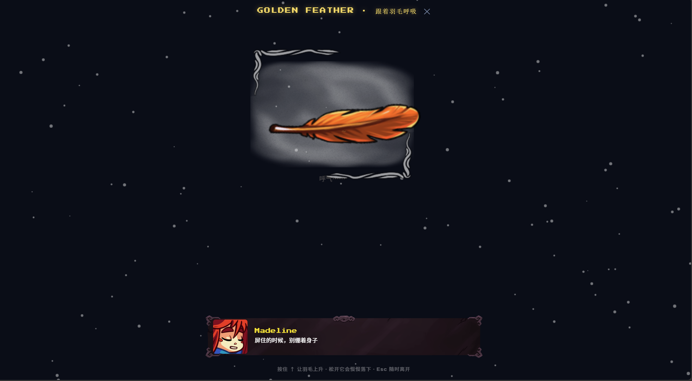
</p>

<picture><source media="(prefers-color-scheme: dark)" srcset="assets/readme/t151-dark.webp"></picture>

<table>
<tr><th align="center"><picture><source media="(prefers-color-scheme: dark)" srcset="assets/readme/t152-dark.webp"></picture></th><th align="left"><picture><source media="(prefers-color-scheme: dark)" srcset="assets/readme/t153-dark.webp"></picture></th></tr>
<tr><td align="center"><picture><source media="(prefers-color-scheme: dark)" srcset="assets/readme/t154-dark.webp"></picture></td><td align="left"><picture><source media="(prefers-color-scheme: dark)" srcset="assets/readme/t155-dark.webp"></picture></td></tr>
<tr><td align="center"><picture><source media="(prefers-color-scheme: dark)" srcset="assets/readme/t156-dark.webp"></picture></td><td align="left"><picture><source media="(prefers-color-scheme: dark)" srcset="assets/readme/t157-dark.webp"></picture></td></tr>
</table>

<picture><source media="(prefers-color-scheme: dark)" srcset="assets/readme/t158-dark.webp"></picture>

> <picture><source media="(prefers-color-scheme: dark)" srcset="assets/readme/t159-dark.webp"></picture>

---

### 🌙 <picture><source media="(prefers-color-scheme: dark)" srcset="assets/readme/t160-dark.webp"></picture>

<p align="center">
  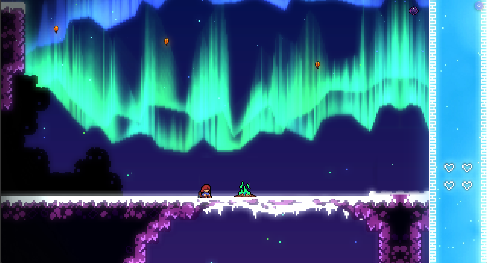
</p>

<picture><source media="(prefers-color-scheme: dark)" srcset="assets/readme/t161-dark.webp"></picture>

### 🪞 <picture><source media="(prefers-color-scheme: dark)" srcset="assets/readme/t162-dark.webp"></picture>

<p align="center">
  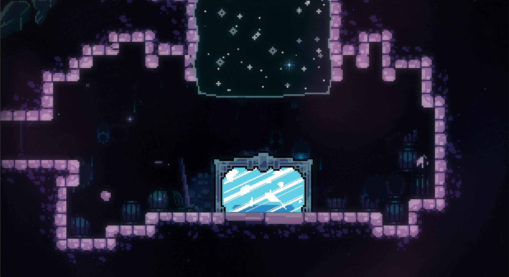
</p>

<picture><source media="(prefers-color-scheme: dark)" srcset="assets/readme/t163-dark.webp"></picture>

---

<a name="dream-mirror-badeline"></a>

## 🪞 <picture><source media="(prefers-color-scheme: dark)" srcset="assets/readme/t164-dark.webp"></picture>

<picture><source media="(prefers-color-scheme: dark)" srcset="assets/readme/t165-dark.webp"></picture>

<table>
<tr><th align="center"><picture><source media="(prefers-color-scheme: dark)" srcset="assets/readme/t166-dark.webp"></picture></th><th align="left"><picture><source media="(prefers-color-scheme: dark)" srcset="assets/readme/t167-dark.webp"></picture></th><th align="left"><picture><source media="(prefers-color-scheme: dark)" srcset="assets/readme/t168-dark.webp"></picture></th></tr>
<tr><td align="center"><picture><source media="(prefers-color-scheme: dark)" srcset="assets/readme/t169-dark.webp"></picture></td><td align="left"><picture><source media="(prefers-color-scheme: dark)" srcset="assets/readme/t170-dark.webp"></picture></td><td align="left"><picture><source media="(prefers-color-scheme: dark)" srcset="assets/readme/t171-dark.webp"></picture></td></tr>
<tr><td align="center"><picture><source media="(prefers-color-scheme: dark)" srcset="assets/readme/t172-dark.webp"></picture></td><td align="left"><picture><source media="(prefers-color-scheme: dark)" srcset="assets/readme/t173-dark.webp">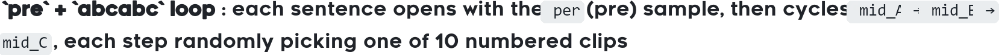</picture></td><td align="left"><picture><source media="(prefers-color-scheme: dark)" srcset="assets/readme/t174-dark.webp"></picture></td></tr>
<tr><td align="center"><picture><source media="(prefers-color-scheme: dark)" srcset="assets/readme/t175-dark.webp"></picture></td><td align="left"><picture><source media="(prefers-color-scheme: dark)" srcset="assets/readme/t176-dark.webp"></picture></td><td align="left"><picture><source media="(prefers-color-scheme: dark)" srcset="assets/readme/t177-dark.webp"></picture></td></tr>
<tr><td align="center"><picture><source media="(prefers-color-scheme: dark)" srcset="assets/readme/t178-dark.webp"></picture></td><td align="left"><picture><source media="(prefers-color-scheme: dark)" srcset="assets/readme/t179-dark.webp"></picture></td><td align="left"><picture><source media="(prefers-color-scheme: dark)" srcset="assets/readme/t180-dark.webp"></picture></td></tr>
<tr><td align="center"><picture><source media="(prefers-color-scheme: dark)" srcset="assets/readme/t181-dark.webp"></picture></td><td align="left"><picture><source media="(prefers-color-scheme: dark)" srcset="assets/readme/t182-dark.webp"></picture></td><td align="left"><picture><source media="(prefers-color-scheme: dark)" srcset="assets/readme/t183-dark.webp"></picture></td></tr>
<tr><td align="center"><picture><source media="(prefers-color-scheme: dark)" srcset="assets/readme/t184-dark.webp"></picture></td><td align="left"><picture><source media="(prefers-color-scheme: dark)" srcset="assets/readme/t185-dark.webp"></picture></td><td align="left"><picture><source media="(prefers-color-scheme: dark)" srcset="assets/readme/t186-dark.webp"></picture></td></tr>
</table>

### 🔊 <picture><source media="(prefers-color-scheme: dark)" srcset="assets/readme/t187-dark.webp"></picture>

<picture><source media="(prefers-color-scheme: dark)" srcset="assets/readme/t188-dark.webp"></picture> <a href="blog-ui/js/badeline-voice.js"><picture><source media="(prefers-color-scheme: dark)" srcset="assets/readme/t189-dark.webp"></picture></a> <picture><source media="(prefers-color-scheme: dark)" srcset="assets/readme/t190-dark.webp"></picture>

- <picture><source media="(prefers-color-scheme: dark)" srcset="assets/readme/t191-dark.webp"></picture>
- <picture><source media="(prefers-color-scheme: dark)" srcset="assets/readme/t192-dark.webp"></picture>
- <picture><source media="(prefers-color-scheme: dark)" srcset="assets/readme/t193-dark.webp"></picture>
- <picture><source media="(prefers-color-scheme: dark)" srcset="assets/readme/t194-dark.webp"></picture>

> <picture><source media="(prefers-color-scheme: dark)" srcset="assets/readme/t195-dark.webp"></picture>

---

<a name="disclaimer"></a>

## 🛡️ <picture><source media="(prefers-color-scheme: dark)" srcset="assets/readme/t196-dark.webp"></picture>

<picture><source media="(prefers-color-scheme: dark)" srcset="assets/readme/t197-dark.webp"></picture>

---

<a name="system-architecture"></a>

## 🏗️ <picture><source media="(prefers-color-scheme: dark)" srcset="assets/readme/t198-dark.webp"></picture>

```
┌─────────────────────────────────────────────────────────────────────────────┐
│                        CELESTE BLOG ECOSYSTEM                              │
├─────────────────────────────────────────────────────────────────────────────┤
│                                                                             │
│  ┌──────────────────┐      ┌──────────────────┐      ┌──────────────────┐  │
│  │   blog-ui/       │      │   blog-api/      │      │  blog-admin/     │  │
│  │  (Frontend)      │◄────►│  (Core API)      │◄────►│  (Admin Panel)   │  │
│  │  Vue 3 (CDN)     │ REST │  Spring Boot     │      │  Spring Boot +   │  │
│  │  CSS/JS          │      │  3.2.6 + MP      │      │  Spring Security │  │
│  │  Port: 8080      │      │  Port: 8888      │      │  Port: 8889      │  │
│  └──────────────────┘      └────────┬─────────┘      └──────────────────┘  │
│                                     │                                      │
│                    ┌────────────────┼────────────────┐                     │
│                    │                │                │                     │
│              ┌─────▼─────┐    ┌─────▼─────┐    ┌─────▼─────┐             │
│              │  MySQL    │    │   Redis   │    │ SiliconFlow│             │
│              │  (blog)   │    │  (Cache/  │    │ (Qwen2.5 + │             │
│              │  :3306    │    │  Session/ │    │  bge-m3)   │             │
│              │           │    │  Token)   │    │  AI Gateway│             │
│              └───────────┘    └───────────┘    └─────────────┘             │
│                                                                             │
└─────────────────────────────────────────────────────────────────────────────┘
```

### <picture><source media="(prefers-color-scheme: dark)" srcset="assets/readme/t199-dark.webp"></picture>

<table>
<tr><th align="left"><picture><source media="(prefers-color-scheme: dark)" srcset="assets/readme/t200-dark.webp"></picture></th><th align="left"><picture><source media="(prefers-color-scheme: dark)" srcset="assets/readme/t201-dark.webp"></picture></th><th align="left"><picture><source media="(prefers-color-scheme: dark)" srcset="assets/readme/t202-dark.webp"></picture></th><th align="left"><picture><source media="(prefers-color-scheme: dark)" srcset="assets/readme/t203-dark.webp"></picture></th></tr>
<tr><td align="left"><picture><source media="(prefers-color-scheme: dark)" srcset="assets/readme/t204-dark.webp"></picture></td><td align="left"><picture><source media="(prefers-color-scheme: dark)" srcset="assets/readme/t205-dark.webp"></picture></td><td align="left"><picture><source media="(prefers-color-scheme: dark)" srcset="assets/readme/t206-dark.webp"></picture></td><td align="left"><picture><source media="(prefers-color-scheme: dark)" srcset="assets/readme/t207-dark.webp"></picture></td></tr>
<tr><td align="left"><picture><source media="(prefers-color-scheme: dark)" srcset="assets/readme/t208-dark.webp"></picture></td><td align="left"><picture><source media="(prefers-color-scheme: dark)" srcset="assets/readme/t209-dark.webp"></picture></td><td align="left"><picture><source media="(prefers-color-scheme: dark)" srcset="assets/readme/t210-dark.webp"></picture></td><td align="left"><picture><source media="(prefers-color-scheme: dark)" srcset="assets/readme/t211-dark.webp"></picture></td></tr>
<tr><td align="left"><picture><source media="(prefers-color-scheme: dark)" srcset="assets/readme/t212-dark.webp"></picture></td><td align="left"><picture><source media="(prefers-color-scheme: dark)" srcset="assets/readme/t213-dark.webp"></picture></td><td align="left"><picture><source media="(prefers-color-scheme: dark)" srcset="assets/readme/t214-dark.webp"></picture></td><td align="left"><picture><source media="(prefers-color-scheme: dark)" srcset="assets/readme/t215-dark.webp"></picture></td></tr>
<tr><td align="left"><picture><source media="(prefers-color-scheme: dark)" srcset="assets/readme/t216-dark.webp"></picture></td><td align="left"><picture><source media="(prefers-color-scheme: dark)" srcset="assets/readme/t217-dark.webp"></picture></td><td align="left"><picture><source media="(prefers-color-scheme: dark)" srcset="assets/readme/t218-dark.webp"></picture></td><td align="left"><picture><source media="(prefers-color-scheme: dark)" srcset="assets/readme/t219-dark.webp"></picture></td></tr>
<tr><td align="left"><picture><source media="(prefers-color-scheme: dark)" srcset="assets/readme/t220-dark.webp"></picture></td><td align="left"><picture><source media="(prefers-color-scheme: dark)" srcset="assets/readme/t221-dark.webp"></picture></td><td align="left"><picture><source media="(prefers-color-scheme: dark)" srcset="assets/readme/t222-dark.webp"></picture></td><td align="left"><picture><source media="(prefers-color-scheme: dark)" srcset="assets/readme/t223-dark.webp"></picture></td></tr>
<tr><td align="left"><picture><source media="(prefers-color-scheme: dark)" srcset="assets/readme/t224-dark.webp"></picture></td><td align="left"><picture><source media="(prefers-color-scheme: dark)" srcset="assets/readme/t225-dark.webp"></picture></td><td align="left"><picture><source media="(prefers-color-scheme: dark)" srcset="assets/readme/t226-dark.webp"></picture></td><td align="left"><picture><source media="(prefers-color-scheme: dark)" srcset="assets/readme/t227-dark.webp"></picture></td></tr>
<tr><td align="left"><picture><source media="(prefers-color-scheme: dark)" srcset="assets/readme/t228-dark.webp"></picture></td><td align="left"><picture><source media="(prefers-color-scheme: dark)" srcset="assets/readme/t229-dark.webp"></picture></td><td align="left"><picture><source media="(prefers-color-scheme: dark)" srcset="assets/readme/t230-dark.webp"></picture></td><td align="left"><picture><source media="(prefers-color-scheme: dark)" srcset="assets/readme/t231-dark.webp"></picture></td></tr>
<tr><td align="left"><picture><source media="(prefers-color-scheme: dark)" srcset="assets/readme/t232-dark.webp"></picture></td><td align="left"><picture><source media="(prefers-color-scheme: dark)" srcset="assets/readme/t233-dark.webp"></picture></td><td align="left"><picture><source media="(prefers-color-scheme: dark)" srcset="assets/readme/t234-dark.webp"></picture></td><td align="left"><picture><source media="(prefers-color-scheme: dark)" srcset="assets/readme/t235-dark.webp"></picture></td></tr>
<tr><td align="left"><picture><source media="(prefers-color-scheme: dark)" srcset="assets/readme/t236-dark.webp"></picture></td><td align="left"><picture><source media="(prefers-color-scheme: dark)" srcset="assets/readme/t237-dark.webp"></picture></td><td align="left"><picture><source media="(prefers-color-scheme: dark)" srcset="assets/readme/t238-dark.webp"></picture></td><td align="left"><picture><source media="(prefers-color-scheme: dark)" srcset="assets/readme/t239-dark.webp"></picture></td></tr>
<tr><td align="left"><picture><source media="(prefers-color-scheme: dark)" srcset="assets/readme/t240-dark.webp"></picture></td><td align="left"><picture><source media="(prefers-color-scheme: dark)" srcset="assets/readme/t241-dark.webp"></picture></td><td align="left"><picture><source media="(prefers-color-scheme: dark)" srcset="assets/readme/t242-dark.webp"></picture></td><td align="left"><picture><source media="(prefers-color-scheme: dark)" srcset="assets/readme/t243-dark.webp"></picture></td></tr>
<tr><td align="left"><picture><source media="(prefers-color-scheme: dark)" srcset="assets/readme/t244-dark.webp"></picture></td><td align="left"><picture><source media="(prefers-color-scheme: dark)" srcset="assets/readme/t245-dark.webp"></picture></td><td align="left"><picture><source media="(prefers-color-scheme: dark)" srcset="assets/readme/t246-dark.webp"></picture></td><td align="left"><picture><source media="(prefers-color-scheme: dark)" srcset="assets/readme/t247-dark.webp"></picture></td></tr>
</table>

---

<a name="project-structure"></a>

## 📁 <picture><source media="(prefers-color-scheme: dark)" srcset="assets/readme/t248-dark.webp"></picture>

```
blog/
├── pom.xml                              # Parent POM (dependency management)
├── README.md                            # This file
├── CONTRIBUTING.md                      # Contribution guidelines
├── LICENSE                              # MIT License
├── TROUBLESHOOTING.md                   # Detailed troubleshooting guide
├── blog-api/                            # Core backend module
│   ├── pom.xml
│   └── src/main/
│       ├── java/com/mszlu/blog/
│       │   ├── config/                  # Configuration classes
│       │   │   ├── ThreadPoolConfig.java     # Bounded async executor
│       │   │   ├── WebMVCConfig.java         # CORS, interceptors
│       │   │   └── MybatisPlusConfig.java    # MP plugins, ID generator
│       │   ├── controller/              # REST endpoints
│       │   │   ├── ArticleController.java    # Blog articles
│       │   │   ├── CategoryController.java   # Categories
│       │   │   ├── ChatController.java       # AI chat
│       │   │   ├── CommentsController.java   # Comments
│       │   │   ├── DiaryController.java      # Diary entries
│       │   │   ├── FeatherController.java    # Feather game
│       │   │   ├── LikeController.java       # Likes
│       │   │   ├── LoginController.java      # Auth (JWT)
│       │   │   ├── LogoutController.java     # Logout
│       │   │   ├── MemoryController.java     # RAG memory
│       │   │   ├── NotificationController.java # Notifications
│       │   │   ├── PersonaController.java    # AI personas
│       │   │   ├── ProactiveController.java    # Proactive AI
│       │   │   ├── RealtimeChatController.java # SSE live chatroom (stream/send/history/typing)
│       │   │   ├── RegisterController.java     # Registration
│       │   │   ├── RoundtableController.java   # AI roundtable SSE (stream/observe/interject/stop)
│       │   │   ├── TagsController.java       # Tags
│       │   │   ├── UploadController.java     # File upload (magic-number validated)
│       │   │   └── UserController.java       # User profile
│       │   ├── dao/
│       │   │   ├── mapper/                # MyBatis mappers
│       │   │   ├── pojo/                  # Entity classes
│       │   │   └── dos/                   # Data objects for complex queries
│       │   ├── handler/
│       │   │   ├── AllExceptionHandler.java    # Global exception handling
│       │   │   └── LoginIntercepter.java       # JWT auth interceptor
│       │   ├── impl/                    # Service implementations
│       │   ├── service/                 # Service interfaces
│       │   │       ├── ai/
│       │   │       │   ├── AiClient.java           # Qwen2.5 client (JSON mode, throttle, 429 retry, circuit breaker)
│       │   │       │   ├── PromptBuilder.java      # Centralized prompt engineering
│       │   │       │   ├── MemorySearchService.java
│       │   │       │   └── roundtable/             # AI roundtable engine
│       │   │       │       ├── RoundtableSession.java    # Session state, CAS start gate, owner generation
│       │   │       │       ├── RoundtableEngine.java     # Turn loop, chunked SSE push, reconnect grace
│       │   │       │       ├── RoundtablePersonas.java   # Slim topic-first persona prompts + common rules
│       │   │       │       ├── SessionBus.java           # Per-subscriber SSE emitter fan-out
│       │   │       │       ├── ConsensusTracker.java     # Agreement/disagreement extraction
│       │   │       │       ├── TurnScheduler.java        # Next-speaker selection
│       │   │       │       ├── RosterBuilder.java        # Character roster assembly
│       │   │       │       └── RoundtableTopicService.java # Topic suggestions & parsing
│       │   ├── utils/
│       │   │   ├── JWTUtils.java               # JWT create/verify (env-configurable)
│       │   │   └── UserThreadLocal.java        # Thread-local user context
│       │   ├── vo/                      # View objects (API contracts)
│       │   └── common/
│       │       ├── aop/                        # Method-level audit logging
│       │       └── cache/                      # Redis caching AOP
│       └── resources/
│           ├── application.properties        # Dev config
│           ├── application-prod.yml          # Production config (HikariCP, security headers)
│           └── log4j2.xml                    # Structured JSON logging
├── blog-admin/                          # Admin backend module
│   └── src/main/java/com/mszlu/blog/admin/
│       ├── config/SecurityConfig.java         # Spring Security form login + RBAC
│       ├── controller/                        # Admin endpoints
│       ├── service/AuthService.java           # URL-level permission check
│       └── ...
└── blog-ui/                             # Frontend static assets
    ├── index.html                       # Blog index
    ├── diary.html                       # Diary main page
    ├── berryos.html                     # BerryOS retro desktop + monthly PPT player
    ├── internet_cafe.html               # Internet Cafe scene: neon animation & interior reveal
    ├── payphone.html                    # Snow-night payphone: Madeline sings
    ├── messages.html                    # SSE live chatroom + like/comment notifications
    ├── roundtable.html                  # Character roundtable with voices
    ├── write.html                       # Writing editor (Markdown + AI tools)
    ├── shelf.html                       # Dream world: Heart Door & Badeline
    ├── shop.html                        # Oshiro Inn (strawberry economy)
    ├── me.html                          # Personal space
    ├── archives.html / article.html     # Blog archives & detail
    ├── login.html / register.html       # Auth pages
    ├── badeline-sounds/                 # Badeline voice clips (10 emotions + sad_solo)
    └── css/  js/  celeste-gui/  celeste-sounds/  celeste-font-en/ ...
```

---

<a name="quick-start"></a>

## 🚀 <picture><source media="(prefers-color-scheme: dark)" srcset="assets/readme/t249-dark.webp"></picture>

### <picture><source media="(prefers-color-scheme: dark)" srcset="assets/readme/t250-dark.webp"></picture>

- <picture><source media="(prefers-color-scheme: dark)" srcset="assets/readme/t251-dark.webp"></picture>
- <picture><source media="(prefers-color-scheme: dark)" srcset="assets/readme/t252-dark.webp"></picture>
- <picture><source media="(prefers-color-scheme: dark)" srcset="assets/readme/t253-dark.webp"></picture>
- <picture><source media="(prefers-color-scheme: dark)" srcset="assets/readme/t254-dark.webp"></picture>
- <picture><source media="(prefers-color-scheme: dark)" srcset="assets/readme/t255-dark.webp"></picture>
- <picture><source media="(prefers-color-scheme: dark)" srcset="assets/readme/t256-dark.webp"></picture>

### <picture><source media="(prefers-color-scheme: dark)" srcset="assets/readme/t257-dark.webp"></picture>

```bash
git clone <repository-url>
cd blog

# Create database
mysql -u root -p -e "CREATE DATABASE blog CHARACTER SET utf8mb4 COLLATE utf8mb4_unicode_ci;"
```

### <picture><source media="(prefers-color-scheme: dark)" srcset="assets/readme/t258-dark.webp"></picture>

<picture><source media="(prefers-color-scheme: dark)" srcset="assets/readme/t259-dark.webp"></picture>

```bash
# === Security (MUST CHANGE IN PROD) ===
export JWT_SECRET="$(openssl rand -base64 48)"
export MYSQL_PASSWORD="your_strong_db_password"
export REDIS_PASSWORD="your_redis_password"

# === External Services ===
export QINIU_ACCESS_KEY="your_qiniu_ak"
export QINIU_SECRET_KEY="your_qiniu_sk"
export AI_API_KEY="your_siliconflow_api_key"
export AI_BASE_URL="https://api.siliconflow.cn/v1"
export AI_MODEL="Qwen/Qwen2.5-7B-Instruct"
export AI_EMBEDDING_MODEL="BAAI/bge-m3"

# === Database (if not localhost) ===
export MYSQL_HOST="your_mysql_host"
export MYSQL_PORT="3306"
export MYSQL_USERNAME="root"
export REDIS_HOST="your_redis_host"
export REDIS_PORT="6379"
```

> <picture><source media="(prefers-color-scheme: dark)" srcset="assets/readme/t260-dark.webp"></picture>

### <picture><source media="(prefers-color-scheme: dark)" srcset="assets/readme/t261-dark.webp"></picture>

```bash
# From project root
mvn clean install -DskipTests

# Run API module (port 8888)
cd blog-api
mvn spring-boot:run -Dspring-boot.run.profiles=dev
```

### <picture><source media="(prefers-color-scheme: dark)" srcset="assets/readme/t262-dark.webp"></picture>

```bash
cd ../blog-admin
mvn spring-boot:run -Dspring-boot.run.profiles=dev   # Port 8889
```

### <picture><source media="(prefers-color-scheme: dark)" srcset="assets/readme/t263-dark.webp"></picture>

```bash
cd ../blog-ui
python3 -m http.server 8080        # Option A: Python (simplest)
# npx serve .                      # Option B: Node.js
```

### <picture><source media="(prefers-color-scheme: dark)" srcset="assets/readme/t264-dark.webp"></picture>

<table>
<tr><th align="left"><picture><source media="(prefers-color-scheme: dark)" srcset="assets/readme/t265-dark.webp"></picture></th><th align="left"><picture><source media="(prefers-color-scheme: dark)" srcset="assets/readme/t266-dark.webp"></picture></th></tr>
<tr><td align="left"><picture><source media="(prefers-color-scheme: dark)" srcset="assets/readme/t267-dark.webp"></picture></td><td align="left"><picture><source media="(prefers-color-scheme: dark)" srcset="assets/readme/t268-dark.webp"></picture></td></tr>
<tr><td align="left"><picture><source media="(prefers-color-scheme: dark)" srcset="assets/readme/t269-dark.webp"></picture></td><td align="left"><picture><source media="(prefers-color-scheme: dark)" srcset="assets/readme/t270-dark.webp"></picture></td></tr>
<tr><td align="left"><picture><source media="(prefers-color-scheme: dark)" srcset="assets/readme/t271-dark.webp"></picture></td><td align="left"><picture><source media="(prefers-color-scheme: dark)" srcset="assets/readme/t272-dark.webp"></picture></td></tr>
<tr><td align="left"><picture><source media="(prefers-color-scheme: dark)" srcset="assets/readme/t273-dark.webp"></picture></td><td align="left"><picture><source media="(prefers-color-scheme: dark)" srcset="assets/readme/t274-dark.webp"></picture></td></tr>
<tr><td align="left"><picture><source media="(prefers-color-scheme: dark)" srcset="assets/readme/t275-dark.webp"></picture></td><td align="left"><picture><source media="(prefers-color-scheme: dark)" srcset="assets/readme/t276-dark.webp"></picture></td></tr>
<tr><td align="left"><picture><source media="(prefers-color-scheme: dark)" srcset="assets/readme/t277-dark.webp"></picture></td><td align="left"><picture><source media="(prefers-color-scheme: dark)" srcset="assets/readme/t278-dark.webp"></picture></td></tr>
<tr><td align="left"><picture><source media="(prefers-color-scheme: dark)" srcset="assets/readme/t279-dark.webp"></picture></td><td align="left"><picture><source media="(prefers-color-scheme: dark)" srcset="assets/readme/t280-dark.webp"></picture></td></tr>
<tr><td align="left"><picture><source media="(prefers-color-scheme: dark)" srcset="assets/readme/t281-dark.webp"></picture></td><td align="left"><picture><source media="(prefers-color-scheme: dark)" srcset="assets/readme/t282-dark.webp"></picture></td></tr>
<tr><td align="left"><picture><source media="(prefers-color-scheme: dark)" srcset="assets/readme/t283-dark.webp"></picture></td><td align="left"><picture><source media="(prefers-color-scheme: dark)" srcset="assets/readme/t284-dark.webp"></picture></td></tr>
<tr><td align="left"><picture><source media="(prefers-color-scheme: dark)" srcset="assets/readme/t285-dark.webp"></picture></td><td align="left"><picture><source media="(prefers-color-scheme: dark)" srcset="assets/readme/t286-dark.webp"></picture></td></tr>
<tr><td align="left"><picture><source media="(prefers-color-scheme: dark)" srcset="assets/readme/t287-dark.webp"></picture></td><td align="left"><picture><source media="(prefers-color-scheme: dark)" srcset="assets/readme/t288-dark.webp"></picture></td></tr>
</table>

---

<a name="configuration-deep-dive"></a>

## ⚙️ <picture><source media="(prefers-color-scheme: dark)" srcset="assets/readme/t289-dark.webp"></picture>

### <picture><source media="(prefers-color-scheme: dark)" srcset="assets/readme/t290-dark.webp"></picture>

```properties
# Server
server.port=8888
spring.application.name=mszlu_blog
spring.profiles.active=dev

# Database
spring.datasource.url=jdbc:mysql://localhost:3306/blog?useUnicode=true&characterEncoding=UTF-8&serverTimeZone=UTC
spring.datasource.username=root
spring.datasource.password=${MYSQL_PASSWORD:your_password}
spring.datasource.driver-class-name=com.mysql.cj.jdbc.Driver

# MyBatis-Plus
mybatis-plus.configuration.log-impl=org.apache.ibatis.logging.stdout.StdOutImpl
mybatis-plus.global-config.db-config.table-prefix=ms_
mybatis-plus.mapper-locations=classpath*:com/mszlu/blog/dao/mapper/**/*.xml

# Upload limits
spring.servlet.multipart.max-request-size=20MB
spring.servlet.multipart.max-file-size=8MB

# Qiniu Cloud Storage
qiniu.accessKey=${QINIU_ACCESS_KEY:your-access-key}
qiniu.accessSecretKey=${QINIU_ACCESS_SECRET_KEY:your-secret-key}

# AI (SiliconFlow)
ai.base-url=${AI_BASE_URL:https://api.siliconflow.cn/v1}
ai.api-key=${AI_API_KEY:your-api-key}
ai.model=${AI_MODEL:Qwen/Qwen2.5-7B-Instruct}
ai.embedding-model=${AI_EMBEDDING_MODEL:BAAI/bge-m3}
# AI resilience: global throttle, 429 backoff, circuit breaker
ai.min-interval-ms=800          # min gap between any two AI requests
ai.rate-limit.retries=3         # retries on HTTP 429
ai.rate-limit.backoff-ms=2000   # exponential base: 2s, 4s, 8s
ai.max-retries=1                # retries for 5xx / timeout
ai.circuit.failure-threshold=5  # consecutive failures before opening
ai.circuit.open-duration=30000  # open circuit cooldown (ms)

# JWT (env-configurable)
jwt.secret=${JWT_SECRET:123456Mszlu!@###$$}
jwt.expiration=2592000000

# Actuator & Prometheus
management.endpoints.web.exposure.include=health,info,prometheus,metrics
management.endpoint.health.show-details=always
management.prometheus.metrics.export.enabled=true
```

### <picture><source media="(prefers-color-scheme: dark)" srcset="assets/readme/t291-dark.webp"></picture>

```yaml
spring:
  datasource:
    hikari:
      maximum-pool-size: 20
      minimum-idle: 5
      idle-timeout: 300000
      max-lifetime: 1200000
      connection-timeout: 30000
  redis:
    lettuce:
      pool: { max-active: 20, max-idle: 10, min-idle: 2 }

server:
  headers:
    x-content-type-options: nosniff
    x-frame-options: DENY
    x-xss-protection: "1; mode=block"

springdoc:
  api-docs: { enabled: false }
  swagger-ui: { enabled: false }

logging:
  level: { root: INFO, com.mszlu.blog: INFO }
  file: { name: logs/blog-api.log, max-size: 100MB, max-history: 30 }
```

---

<a name="core-features-explained"></a>

## 🎯 <picture><source media="(prefers-color-scheme: dark)" srcset="assets/readme/t292-dark.webp"></picture>

### <picture><source media="(prefers-color-scheme: dark)" srcset="assets/readme/t293-dark.webp"></picture>

<picture><source media="(prefers-color-scheme: dark)" srcset="assets/readme/t294-dark.webp"></picture>

- <picture><source media="(prefers-color-scheme: dark)" srcset="assets/readme/t295-dark.webp"></picture>
- <picture><source media="(prefers-color-scheme: dark)" srcset="assets/readme/t296-dark.webp"></picture>
- <picture><source media="(prefers-color-scheme: dark)" srcset="assets/readme/t297-dark.webp"></picture>
- <picture><source media="(prefers-color-scheme: dark)" srcset="assets/readme/t298-dark.webp"></picture>

<picture><source media="(prefers-color-scheme: dark)" srcset="assets/readme/t299-dark.webp"></picture>

<picture><source media="(prefers-color-scheme: dark)" srcset="assets/readme/t300-dark.webp"></picture>

- <picture><source media="(prefers-color-scheme: dark)" srcset="assets/readme/t301-dark.webp"></picture>
- <picture><source media="(prefers-color-scheme: dark)" srcset="assets/readme/t302-dark.webp"></picture>
- <picture><source media="(prefers-color-scheme: dark)" srcset="assets/readme/t303-dark.webp"></picture>
- <picture><source media="(prefers-color-scheme: dark)" srcset="assets/readme/t304-dark.webp"></picture>

<picture><source media="(prefers-color-scheme: dark)" srcset="assets/readme/t305-dark.webp"></picture>

- <picture><source media="(prefers-color-scheme: dark)" srcset="assets/readme/t306-dark.webp"></picture>
- <picture><source media="(prefers-color-scheme: dark)" srcset="assets/readme/t307-dark.webp"></picture>
- <picture><source media="(prefers-color-scheme: dark)" srcset="assets/readme/t308-dark.webp"></picture>

### <picture><source media="(prefers-color-scheme: dark)" srcset="assets/readme/t309-dark.webp"></picture>

```
┌─────────────┐     ┌─────────────┐     ┌─────────────┐
│  Write      │────►│  Diary      │────►│  Publish    │
│  (Private)  │     │  (Saved)    │     │  (Public)   │
└─────────────┘     └─────────────┘     └─────────────┘
                           │                    │
                    ┌──────▼──────┐       ┌──────▼──────┐
                    │  AI Feedback│       │  Blog Feed  │
                    │  + Emotion  │       │  + Comments │
                    └─────────────┘       └─────────────┘
```

- <picture><source media="(prefers-color-scheme: dark)" srcset="assets/readme/t310-dark.webp"></picture>
- <picture><source media="(prefers-color-scheme: dark)" srcset="assets/readme/t311-dark.webp"></picture>
- <picture><source media="(prefers-color-scheme: dark)" srcset="assets/readme/t312-dark.webp"></picture>

### <picture><source media="(prefers-color-scheme: dark)" srcset="assets/readme/t313-dark.webp"></picture>

<table>
<tr><th align="left"><picture><source media="(prefers-color-scheme: dark)" srcset="assets/readme/t314-dark.webp"></picture></th><th align="left"><picture><source media="(prefers-color-scheme: dark)" srcset="assets/readme/t315-dark.webp"></picture></th><th align="left"><picture><source media="(prefers-color-scheme: dark)" srcset="assets/readme/t316-dark.webp"></picture></th></tr>
<tr><td align="left"><picture><source media="(prefers-color-scheme: dark)" srcset="assets/readme/t317-dark.webp"></picture></td><td align="left"><picture><source media="(prefers-color-scheme: dark)" srcset="assets/readme/t318-dark.webp"></picture></td><td align="left"><picture><source media="(prefers-color-scheme: dark)" srcset="assets/readme/t319-dark.webp"></picture></td></tr>
<tr><td align="left"><picture><source media="(prefers-color-scheme: dark)" srcset="assets/readme/t320-dark.webp"></picture></td><td align="left"><picture><source media="(prefers-color-scheme: dark)" srcset="assets/readme/t321-dark.webp"></picture></td><td align="left"><picture><source media="(prefers-color-scheme: dark)" srcset="assets/readme/t322-dark.webp"></picture></td></tr>
<tr><td align="left"><picture><source media="(prefers-color-scheme: dark)" srcset="assets/readme/t323-dark.webp"></picture></td><td align="left"><picture><source media="(prefers-color-scheme: dark)" srcset="assets/readme/t324-dark.webp"></picture></td><td align="left"><picture><source media="(prefers-color-scheme: dark)" srcset="assets/readme/t325-dark.webp"></picture></td></tr>
</table>

### <picture><source media="(prefers-color-scheme: dark)" srcset="assets/readme/t326-dark.webp"></picture>

- <picture><source media="(prefers-color-scheme: dark)" srcset="assets/readme/t327-dark.webp"></picture>
- <picture><source media="(prefers-color-scheme: dark)" srcset="assets/readme/t328-dark.webp"></picture>
- <picture><source media="(prefers-color-scheme: dark)" srcset="assets/readme/t329-dark.webp"></picture>

### <picture><source media="(prefers-color-scheme: dark)" srcset="assets/readme/t330-dark.webp"></picture>

<table>
<tr><th align="left"><picture><source media="(prefers-color-scheme: dark)" srcset="assets/readme/t331-dark.webp"></picture></th><th align="left"><picture><source media="(prefers-color-scheme: dark)" srcset="assets/readme/t332-dark.webp"></picture></th></tr>
<tr><td align="left"><picture><source media="(prefers-color-scheme: dark)" srcset="assets/readme/t333-dark.webp"></picture></td><td align="left"><picture><source media="(prefers-color-scheme: dark)" srcset="assets/readme/t334-dark.webp"></picture></td></tr>
<tr><td align="left"><picture><source media="(prefers-color-scheme: dark)" srcset="assets/readme/t335-dark.webp"></picture></td><td align="left"><picture><source media="(prefers-color-scheme: dark)" srcset="assets/readme/t336-dark.webp">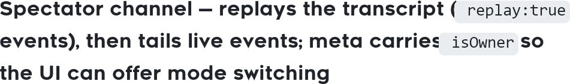</picture></td></tr>
<tr><td align="left"><picture><source media="(prefers-color-scheme: dark)" srcset="assets/readme/t337-dark.webp"></picture></td><td align="left"><picture><source media="(prefers-color-scheme: dark)" srcset="assets/readme/t338-dark.webp"></picture></td></tr>
<tr><td align="left"><picture><source media="(prefers-color-scheme: dark)" srcset="assets/readme/t339-dark.webp"></picture></td><td align="left"><picture><source media="(prefers-color-scheme: dark)" srcset="assets/readme/t340-dark.webp"></picture></td></tr>
<tr><td align="left"><picture><source media="(prefers-color-scheme: dark)" srcset="assets/readme/t341-dark.webp"></picture></td><td align="left"><picture><source media="(prefers-color-scheme: dark)" srcset="assets/readme/t342-dark.webp"></picture></td></tr>
<tr><td align="left"><picture><source media="(prefers-color-scheme: dark)" srcset="assets/readme/t343-dark.webp">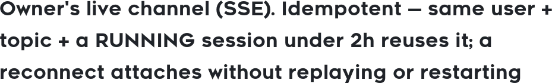</picture></td><td align="left"><picture><source media="(prefers-color-scheme: dark)" srcset="assets/readme/t344-dark.webp"></picture></td></tr>
<tr><td align="left"><picture><source media="(prefers-color-scheme: dark)" srcset="assets/readme/t345-dark.webp"></picture></td><td align="left"><picture><source media="(prefers-color-scheme: dark)" srcset="assets/readme/t346-dark.webp"></picture></td></tr>
</table>

### <picture><source media="(prefers-color-scheme: dark)" srcset="assets/readme/t347-dark.webp"></picture>

<picture><source media="(prefers-color-scheme: dark)" srcset="assets/readme/t348-dark.webp"></picture>

<picture><source media="(prefers-color-scheme: dark)" srcset="assets/readme/t349-dark.webp"></picture>

<table>
<tr><th align="left"><picture><source media="(prefers-color-scheme: dark)" srcset="assets/readme/t350-dark.webp"></picture></th><th align="left"><picture><source media="(prefers-color-scheme: dark)" srcset="assets/readme/t351-dark.webp"></picture></th></tr>
<tr><td align="left"><picture><source media="(prefers-color-scheme: dark)" srcset="assets/readme/t352-dark.webp"></picture></td><td align="left"><picture><source media="(prefers-color-scheme: dark)" srcset="assets/readme/t353-dark.webp"></picture></td></tr>
<tr><td align="left"><picture><source media="(prefers-color-scheme: dark)" srcset="assets/readme/t354-dark.webp"></picture></td><td align="left"><picture><source media="(prefers-color-scheme: dark)" srcset="assets/readme/t355-dark.webp"></picture></td></tr>
<tr><td align="left"><picture><source media="(prefers-color-scheme: dark)" srcset="assets/readme/t356-dark.webp"></picture></td><td align="left"><picture><source media="(prefers-color-scheme: dark)" srcset="assets/readme/t357-dark.webp"></picture></td></tr>
<tr><td align="left"><picture><source media="(prefers-color-scheme: dark)" srcset="assets/readme/t358-dark.webp"></picture></td><td align="left"><picture><source media="(prefers-color-scheme: dark)" srcset="assets/readme/t359-dark.webp"></picture></td></tr>
<tr><td align="left"><picture><source media="(prefers-color-scheme: dark)" srcset="assets/readme/t360-dark.webp"></picture></td><td align="left"><picture><source media="(prefers-color-scheme: dark)" srcset="assets/readme/t361-dark.webp"></picture></td></tr>
<tr><td align="left"><picture><source media="(prefers-color-scheme: dark)" srcset="assets/readme/t362-dark.webp"></picture></td><td align="left"><picture><source media="(prefers-color-scheme: dark)" srcset="assets/readme/t363-dark.webp"></picture></td></tr>
</table>

<picture><source media="(prefers-color-scheme: dark)" srcset="assets/readme/t364-dark.webp"></picture>

- <picture><source media="(prefers-color-scheme: dark)" srcset="assets/readme/t365-dark.webp"></picture>
- <picture><source media="(prefers-color-scheme: dark)" srcset="assets/readme/t366-dark.webp">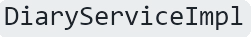</picture>
- <picture><source media="(prefers-color-scheme: dark)" srcset="assets/readme/t367-dark.webp"></picture>
- <picture><source media="(prefers-color-scheme: dark)" srcset="assets/readme/t368-dark.webp"></picture>

<picture><source media="(prefers-color-scheme: dark)" srcset="assets/readme/t369-dark.webp"></picture>

<picture><source media="(prefers-color-scheme: dark)" srcset="assets/readme/t370-dark.webp"></picture>

1. <picture><source media="(prefers-color-scheme: dark)" srcset="assets/readme/t371-dark.webp"></picture>
2. <picture><source media="(prefers-color-scheme: dark)" srcset="assets/readme/t372-dark.webp"></picture>
3. <picture><source media="(prefers-color-scheme: dark)" srcset="assets/readme/t373-dark.webp"></picture>
4. <picture><source media="(prefers-color-scheme: dark)" srcset="assets/readme/t374-dark.webp"></picture>

<picture><source media="(prefers-color-scheme: dark)" srcset="assets/readme/t375-dark.webp"></picture>

### <picture><source media="(prefers-color-scheme: dark)" srcset="assets/readme/t376-dark.webp"></picture>

<picture><source media="(prefers-color-scheme: dark)" srcset="assets/readme/t377-dark.webp"></picture>

<picture><source media="(prefers-color-scheme: dark)" srcset="assets/readme/t378-dark.webp"></picture>

<table>
<tr><th align="left"><picture><source media="(prefers-color-scheme: dark)" srcset="assets/readme/t379-dark.webp"></picture></th><th align="left"><picture><source media="(prefers-color-scheme: dark)" srcset="assets/readme/t380-dark.webp"></picture></th></tr>
<tr><td align="left"><picture><source media="(prefers-color-scheme: dark)" srcset="assets/readme/t381-dark.webp"></picture></td><td align="left"><picture><source media="(prefers-color-scheme: dark)" srcset="assets/readme/t382-dark.webp"></picture></td></tr>
<tr><td align="left"><picture><source media="(prefers-color-scheme: dark)" srcset="assets/readme/t383-dark.webp"></picture></td><td align="left"><picture><source media="(prefers-color-scheme: dark)" srcset="assets/readme/t384-dark.webp"></picture></td></tr>
<tr><td align="left"><picture><source media="(prefers-color-scheme: dark)" srcset="assets/readme/t385-dark.webp"></picture></td><td align="left"><picture><source media="(prefers-color-scheme: dark)" srcset="assets/readme/t386-dark.webp"></picture></td></tr>
<tr><td align="left"><picture><source media="(prefers-color-scheme: dark)" srcset="assets/readme/t387-dark.webp"></picture></td><td align="left"><picture><source media="(prefers-color-scheme: dark)" srcset="assets/readme/t388-dark.webp"></picture></td></tr>
</table>

<picture><source media="(prefers-color-scheme: dark)" srcset="assets/readme/t389-dark.webp"></picture>

- <picture><source media="(prefers-color-scheme: dark)" srcset="assets/readme/t390-dark.webp"></picture>
- <picture><source media="(prefers-color-scheme: dark)" srcset="assets/readme/t391-dark.webp"></picture>
- <picture><source media="(prefers-color-scheme: dark)" srcset="assets/readme/t392-dark.webp"></picture>
- <picture><source media="(prefers-color-scheme: dark)" srcset="assets/readme/t393-dark.webp"></picture>

<picture><source media="(prefers-color-scheme: dark)" srcset="assets/readme/t394-dark.webp"></picture>

---

<a name="technical-deep-dive"></a>

## 📚 <picture><source media="(prefers-color-scheme: dark)" srcset="assets/readme/t395-dark.webp"></picture>

### <picture><source media="(prefers-color-scheme: dark)" srcset="assets/readme/t396-dark.webp"></picture>

<table>
<tr><th align="left"><picture><source media="(prefers-color-scheme: dark)" srcset="assets/readme/t397-dark.webp"></picture></th><th align="left"><picture><source media="(prefers-color-scheme: dark)" srcset="assets/readme/t398-dark.webp"></picture></th></tr>
<tr><td align="left"><picture><source media="(prefers-color-scheme: dark)" srcset="assets/readme/t399-dark.webp"></picture></td><td align="left"><picture><source media="(prefers-color-scheme: dark)" srcset="assets/readme/t400-dark.webp"></picture></td></tr>
<tr><td align="left"><picture><source media="(prefers-color-scheme: dark)" srcset="assets/readme/t401-dark.webp"></picture></td><td align="left"><picture><source media="(prefers-color-scheme: dark)" srcset="assets/readme/t402-dark.webp"></picture></td></tr>
<tr><td align="left"><picture><source media="(prefers-color-scheme: dark)" srcset="assets/readme/t403-dark.webp"></picture></td><td align="left"><picture><source media="(prefers-color-scheme: dark)" srcset="assets/readme/t404-dark.webp"></picture></td></tr>
<tr><td align="left"><picture><source media="(prefers-color-scheme: dark)" srcset="assets/readme/t405-dark.webp"></picture></td><td align="left"><picture><source media="(prefers-color-scheme: dark)" srcset="assets/readme/t406-dark.webp"></picture></td></tr>
<tr><td align="left"><picture><source media="(prefers-color-scheme: dark)" srcset="assets/readme/t407-dark.webp"></picture></td><td align="left"><picture><source media="(prefers-color-scheme: dark)" srcset="assets/readme/t408-dark.webp"></picture></td></tr>
<tr><td align="left"><picture><source media="(prefers-color-scheme: dark)" srcset="assets/readme/t409-dark.webp"></picture></td><td align="left"><picture><source media="(prefers-color-scheme: dark)" srcset="assets/readme/t410-dark.webp"></picture></td></tr>
<tr><td align="left"><picture><source media="(prefers-color-scheme: dark)" srcset="assets/readme/t411-dark.webp"></picture></td><td align="left"><picture><source media="(prefers-color-scheme: dark)" srcset="assets/readme/t412-dark.webp"></picture></td></tr>
<tr><td align="left"><picture><source media="(prefers-color-scheme: dark)" srcset="assets/readme/t413-dark.webp"></picture></td><td align="left"><picture><source media="(prefers-color-scheme: dark)" srcset="assets/readme/t414-dark.webp"></picture></td></tr>
<tr><td align="left"><picture><source media="(prefers-color-scheme: dark)" srcset="assets/readme/t415-dark.webp"></picture></td><td align="left"><picture><source media="(prefers-color-scheme: dark)" srcset="assets/readme/t416-dark.webp"></picture></td></tr>
</table>

### <picture><source media="(prefers-color-scheme: dark)" srcset="assets/readme/t417-dark.webp"></picture>

```
blog-ui/
├── index.html          → Blog feed (category filter, search, popular, tags)
├── diary.html          → Postcard viewer + Madeline chat (~2400-line diary.js)
├── berryos.html        → BerryOS retro desktop + monthly PPT player
├── internet_cafe.html  → Neon-sign scene with layered interior reveal
├── payphone.html       → Snow-night payphone: Madeline sings
├── messages.html       → SSE live chatroom (group chat + notify column)
├── roundtable.html     → Character roundtable: SSE debate, idempotent reconnect, buffered typewriter
├── write.html          → Markdown editor + AI toolbar (Polish, Generate, Madeline)
├── shelf.html          → Dream world (Heart Door, mirror room, Badeline)
├── shop.html           → Oshiro Inn (dialogue, strawberry shop)
├── me.html             → Profile, stats, collection, settings
├── article.html        → Blog article detail (content, comments, likes)
├── archives.html       → Chronological archive
└── login/register.html → Auth pages (JWT token → localStorage)
```

<picture><source media="(prefers-color-scheme: dark)" srcset="assets/readme/t418-dark.webp"></picture>

- <picture><source media="(prefers-color-scheme: dark)" srcset="assets/readme/t419-dark.webp"></picture>
- <picture><source media="(prefers-color-scheme: dark)" srcset="assets/readme/t420-dark.webp"></picture>
- <picture><source media="(prefers-color-scheme: dark)" srcset="assets/readme/t421-dark.webp"></picture>
- <picture><source media="(prefers-color-scheme: dark)" srcset="assets/readme/t422-dark.webp"></picture>
- <picture><source media="(prefers-color-scheme: dark)" srcset="assets/readme/t423-dark.webp"></picture>

---

<a name="testing-quality"></a>

## 🧪 <picture><source media="(prefers-color-scheme: dark)" srcset="assets/readme/t424-dark.webp"></picture>

### <picture><source media="(prefers-color-scheme: dark)" srcset="assets/readme/t425-dark.webp"></picture>

- <picture><source media="(prefers-color-scheme: dark)" srcset="assets/readme/t426-dark.webp"></picture>
- <picture><source media="(prefers-color-scheme: dark)" srcset="assets/readme/t427-dark.webp"></picture>
- <picture><source media="(prefers-color-scheme: dark)" srcset="assets/readme/t428-dark.webp"></picture>
- <picture><source media="(prefers-color-scheme: dark)" srcset="assets/readme/t429-dark.webp"></picture>
- <picture><source media="(prefers-color-scheme: dark)" srcset="assets/readme/t430-dark.webp"></picture>

### <picture><source media="(prefers-color-scheme: dark)" srcset="assets/readme/t431-dark.webp"></picture>

```xml
<!-- Parent pom.xml <dependencyManagement> -->
<dependency>
    <groupId>org.testcontainers</groupId>
    <artifactId>testcontainers-bom</artifactId>
    <version>1.19.0</version>
    <type>pom</type>
    <scope>import</scope>
</dependency>

<!-- blog-api/pom.xml -->
<dependency>
    <groupId>org.testcontainers</groupId>
    <artifactId>junit-jupiter</artifactId>
    <scope>test</scope>
</dependency>
<dependency>
    <groupId>org.testcontainers</groupId>
    <artifactId>mysql</artifactId>
    <scope>test</scope>
</dependency>
<dependency>
    <groupId>org.testcontainers</groupId>
    <artifactId>redis</artifactId>
    <scope>test</scope>
</dependency>
```

### <picture><source media="(prefers-color-scheme: dark)" srcset="assets/readme/t432-dark.webp"></picture>

<picture><source media="(prefers-color-scheme: dark)" srcset="assets/readme/t433-dark.webp"></picture>

---

<a name="deployment-guide"></a>

## 📦 <picture><source media="(prefers-color-scheme: dark)" srcset="assets/readme/t434-dark.webp"></picture>

### <picture><source media="(prefers-color-scheme: dark)" srcset="assets/readme/t435-dark.webp"></picture>

```yaml
# docker-compose.yml
version: '3.8'
services:
  mysql:
    image: mysql:8.0
    environment:
      MYSQL_DATABASE: blog
      MYSQL_ROOT_PASSWORD: ${MYSQL_PASSWORD}
    volumes: [ mysql_data:/var/lib/mysql ]
    healthcheck:
      test: ["CMD", "mysqladmin", "ping", "-h", "localhost"]
      interval: 10s
      timeout: 5s
      retries: 5

  redis:
    image: redis:7-alpine
    command: redis-server --requirepass ${REDIS_PASSWORD}
    volumes: [ redis_data:/data ]
    healthcheck:
      test: ["CMD", "redis-cli", "ping"]
      interval: 10s

  blog-api:
    build: ./blog-api
    ports: ["8888:8888"]
    environment:
      SPRING_PROFILES_ACTIVE: prod
      MYSQL_HOST: mysql
      REDIS_HOST: redis
      JWT_SECRET: ${JWT_SECRET}
      QINIU_ACCESS_KEY: ${QINIU_ACCESS_KEY}
      QINIU_SECRET_KEY: ${QINIU_SECRET_KEY}
      AI_API_KEY: ${AI_API_KEY}
    depends_on:
      mysql: { condition: service_healthy }
      redis: { condition: service_healthy }
    restart: unless-stopped

  blog-admin:
    build: ./blog-admin
    ports: ["8889:8889"]
    environment:
      SPRING_PROFILES_ACTIVE: prod
      MYSQL_HOST: mysql
    depends_on:
      mysql: { condition: service_healthy }
    restart: unless-stopped

  nginx:
    image: nginx:alpine
    ports: ["80:80", "443:443"]
    volumes:
      - ./nginx.conf:/etc/nginx/nginx.conf:ro
      - ./blog-ui:/usr/share/nginx/html:ro
    depends_on: [blog-api, blog-admin]
    restart: unless-stopped

volumes:
  mysql_data:
  redis_data:
```

<picture><source media="(prefers-color-scheme: dark)" srcset="assets/readme/t436-dark.webp"></picture>

```nginx
events { worker_connections 1024; }
http {
  upstream api   { server blog-api:8888; }
  upstream admin { server blog-admin:8889; }

  server {
    listen 80;
    server_name your-domain.com;
    return 301 https://$server_name$request_uri;
  }

  server {
    listen 443 ssl http2;
    server_name your-domain.com;
    ssl_certificate     /etc/ssl/certs/cert.pem;
    ssl_certificate_key /etc/ssl/private/key.pem;

    location / {
      root /usr/share/nginx/html;
      try_files $uri $uri/ /index.html;
    }
    location /api/ {
      proxy_pass http://api;
      proxy_set_header Host $host;
      proxy_set_header X-Real-IP $remote_addr;
      proxy_set_header X-Forwarded-For $proxy_add_x_forwarded_for;
      proxy_set_header X-Forwarded-Proto $scheme;
    }
    location /admin/ {
      proxy_pass http://admin;
      proxy_set_header Host $host;
      proxy_set_header X-Real-IP $remote_addr;
    }
    location /actuator/ {
      allow 10.0.0.0/8;
      deny all;
      proxy_pass http://api;
    }
  }
}
```

### <picture><source media="(prefers-color-scheme: dark)" srcset="assets/readme/t437-dark.webp"></picture>

```yaml
# helm/values.yaml (key configs)
blog-api:
  replicaCount: 3
  resources:
    limits:   { cpu: "1000m", memory: "1Gi" }
    requests: { cpu: "500m",  memory: "512Mi" }
  autoscaling:
    enabled: true
    minReplicas: 3
    maxReplicas: 10
    targetCPUUtilization: 70
  env:
    - name: JWT_SECRET
      valueFrom: { secretKeyRef: { name: blog-secrets, key: jwt-secret } }
    - name: MYSQL_PASSWORD
      valueFrom: { secretKeyRef: { name: blog-secrets, key: mysql-password } }
blog-admin: { replicaCount: 2 }
nginx:      { replicaCount: 2 }   # TLS via cert-manager + Let's Encrypt
```

---

<a name="contribution-guide"></a>

## 🤝 <picture><source media="(prefers-color-scheme: dark)" srcset="assets/readme/t438-dark.webp"></picture>

<picture><source media="(prefers-color-scheme: dark)" srcset="assets/readme/t439-dark.webp"></picture> <a href="CONTRIBUTING.md"><picture><source media="(prefers-color-scheme: dark)" srcset="assets/readme/t440-dark.webp"></picture></a> <picture><source media="(prefers-color-scheme: dark)" srcset="assets/readme/t441-dark.webp"></picture>

### <picture><source media="(prefers-color-scheme: dark)" srcset="assets/readme/t442-dark.webp"></picture>

```bash
git clone https://github.com/your-username/blog.git
cd blog
git checkout -b feature/your-feature-name
# make changes
mvn clean test -pl blog-api,blog-admin
git commit -m "feat(diary): add emotion trend chart to monthly snapshot"
git push origin feature/your-feature-name
# Open PR against main branch
```

### <picture><source media="(prefers-color-scheme: dark)" srcset="assets/readme/t443-dark.webp"></picture>

1. <picture><source media="(prefers-color-scheme: dark)" srcset="assets/readme/t444-dark.webp"></picture>
2. <picture><source media="(prefers-color-scheme: dark)" srcset="assets/readme/t445-dark.webp"></picture>
3. <picture><source media="(prefers-color-scheme: dark)" srcset="assets/readme/t446-dark.webp"></picture>
4. <picture><source media="(prefers-color-scheme: dark)" srcset="assets/readme/t447-dark.webp"></picture>
5. <picture><source media="(prefers-color-scheme: dark)" srcset="assets/readme/t448-dark.webp"></picture>
6. <picture><source media="(prefers-color-scheme: dark)" srcset="assets/readme/t449-dark.webp"></picture>
7. <picture><source media="(prefers-color-scheme: dark)" srcset="assets/readme/t450-dark.webp"></picture>
8. <picture><source media="(prefers-color-scheme: dark)" srcset="assets/readme/t451-dark.webp"></picture>

### <picture><source media="(prefers-color-scheme: dark)" srcset="assets/readme/t452-dark.webp"></picture>

<table>
<tr><th align="left"><picture><source media="(prefers-color-scheme: dark)" srcset="assets/readme/t453-dark.webp"></picture></th><th align="left"><picture><source media="(prefers-color-scheme: dark)" srcset="assets/readme/t454-dark.webp"></picture></th><th align="left"><picture><source media="(prefers-color-scheme: dark)" srcset="assets/readme/t455-dark.webp"></picture></th></tr>
<tr><td align="left"><picture><source media="(prefers-color-scheme: dark)" srcset="assets/readme/t456-dark.webp"></picture></td><td align="left"><picture><source media="(prefers-color-scheme: dark)" srcset="assets/readme/t457-dark.webp"></picture></td><td align="left"><picture><source media="(prefers-color-scheme: dark)" srcset="assets/readme/t458-dark.webp"></picture></td></tr>
<tr><td align="left"><picture><source media="(prefers-color-scheme: dark)" srcset="assets/readme/t459-dark.webp"></picture></td><td align="left"><picture><source media="(prefers-color-scheme: dark)" srcset="assets/readme/t460-dark.webp"></picture></td><td align="left"><picture><source media="(prefers-color-scheme: dark)" srcset="assets/readme/t461-dark.webp"></picture></td></tr>
<tr><td align="left"><picture><source media="(prefers-color-scheme: dark)" srcset="assets/readme/t462-dark.webp"></picture></td><td align="left"><picture><source media="(prefers-color-scheme: dark)" srcset="assets/readme/t463-dark.webp"></picture></td><td align="left"><picture><source media="(prefers-color-scheme: dark)" srcset="assets/readme/t464-dark.webp"></picture></td></tr>
<tr><td align="left"><picture><source media="(prefers-color-scheme: dark)" srcset="assets/readme/t465-dark.webp"></picture></td><td align="left"><picture><source media="(prefers-color-scheme: dark)" srcset="assets/readme/t466-dark.webp"></picture></td><td align="left"><picture><source media="(prefers-color-scheme: dark)" srcset="assets/readme/t467-dark.webp"></picture></td></tr>
<tr><td align="left"><picture><source media="(prefers-color-scheme: dark)" srcset="assets/readme/t468-dark.webp"></picture></td><td align="left"><picture><source media="(prefers-color-scheme: dark)" srcset="assets/readme/t469-dark.webp"></picture></td><td align="left"><picture><source media="(prefers-color-scheme: dark)" srcset="assets/readme/t470-dark.webp"></picture></td></tr>
<tr><td align="left"><picture><source media="(prefers-color-scheme: dark)" srcset="assets/readme/t471-dark.webp"></picture></td><td align="left"><picture><source media="(prefers-color-scheme: dark)" srcset="assets/readme/t472-dark.webp"></picture></td><td align="left"><picture><source media="(prefers-color-scheme: dark)" srcset="assets/readme/t473-dark.webp"></picture></td></tr>
</table>

---

<a name="faq-troubleshooting"></a>

## ❓ <picture><source media="(prefers-color-scheme: dark)" srcset="assets/readme/t474-dark.webp"></picture>

### <picture><source media="(prefers-color-scheme: dark)" srcset="assets/readme/t475-dark.webp"></picture>

<table>
<tr><th align="left"><picture><source media="(prefers-color-scheme: dark)" srcset="assets/readme/t476-dark.webp"></picture></th><th align="left"><picture><source media="(prefers-color-scheme: dark)" srcset="assets/readme/t477-dark.webp"></picture></th></tr>
<tr><td align="left"><picture><source media="(prefers-color-scheme: dark)" srcset="assets/readme/t478-dark.webp"></picture></td><td align="left"><picture><source media="(prefers-color-scheme: dark)" srcset="assets/readme/t479-dark.webp"></picture></td></tr>
<tr><td align="left"><picture><source media="(prefers-color-scheme: dark)" srcset="assets/readme/t480-dark.webp"></picture></td><td align="left"><picture><source media="(prefers-color-scheme: dark)" srcset="assets/readme/t481-dark.webp"></picture></td></tr>
<tr><td align="left"><picture><source media="(prefers-color-scheme: dark)" srcset="assets/readme/t482-dark.webp"></picture></td><td align="left"><picture><source media="(prefers-color-scheme: dark)" srcset="assets/readme/t483-dark.webp"></picture></td></tr>
<tr><td align="left"><picture><source media="(prefers-color-scheme: dark)" srcset="assets/readme/t484-dark.webp"></picture></td><td align="left"><picture><source media="(prefers-color-scheme: dark)" srcset="assets/readme/t485-dark.webp"></picture></td></tr>
<tr><td align="left"><picture><source media="(prefers-color-scheme: dark)" srcset="assets/readme/t486-dark.webp"></picture></td><td align="left"><picture><source media="(prefers-color-scheme: dark)" srcset="assets/readme/t487-dark.webp"></picture></td></tr>
<tr><td align="left"><picture><source media="(prefers-color-scheme: dark)" srcset="assets/readme/t488-dark.webp"></picture></td><td align="left"><picture><source media="(prefers-color-scheme: dark)" srcset="assets/readme/t489-dark.webp"></picture></td></tr>
</table>

### <picture><source media="(prefers-color-scheme: dark)" srcset="assets/readme/t490-dark.webp"></picture>

<table>
<tr><th align="left"><picture><source media="(prefers-color-scheme: dark)" srcset="assets/readme/t491-dark.webp"></picture></th><th align="left"><picture><source media="(prefers-color-scheme: dark)" srcset="assets/readme/t492-dark.webp"></picture></th></tr>
<tr><td align="left"><picture><source media="(prefers-color-scheme: dark)" srcset="assets/readme/t493-dark.webp"></picture></td><td align="left"><picture><source media="(prefers-color-scheme: dark)" srcset="assets/readme/t494-dark.webp"></picture></td></tr>
<tr><td align="left"><picture><source media="(prefers-color-scheme: dark)" srcset="assets/readme/t495-dark.webp"></picture></td><td align="left"><picture><source media="(prefers-color-scheme: dark)" srcset="assets/readme/t496-dark.webp"></picture></td></tr>
<tr><td align="left"><picture><source media="(prefers-color-scheme: dark)" srcset="assets/readme/t497-dark.webp"></picture></td><td align="left"><picture><source media="(prefers-color-scheme: dark)" srcset="assets/readme/t498-dark.webp"></picture></td></tr>
<tr><td align="left"><picture><source media="(prefers-color-scheme: dark)" srcset="assets/readme/t499-dark.webp"></picture></td><td align="left"><picture><source media="(prefers-color-scheme: dark)" srcset="assets/readme/t500-dark.webp"></picture></td></tr>
<tr><td align="left"><picture><source media="(prefers-color-scheme: dark)" srcset="assets/readme/t501-dark.webp"></picture></td><td align="left"><picture><source media="(prefers-color-scheme: dark)" srcset="assets/readme/t502-dark.webp"></picture></td></tr>
<tr><td align="left"><picture><source media="(prefers-color-scheme: dark)" srcset="assets/readme/t503-dark.webp"></picture></td><td align="left"><picture><source media="(prefers-color-scheme: dark)" srcset="assets/readme/t504-dark.webp"></picture></td></tr>
<tr><td align="left"><picture><source media="(prefers-color-scheme: dark)" srcset="assets/readme/t505-dark.webp"></picture></td><td align="left"><picture><source media="(prefers-color-scheme: dark)" srcset="assets/readme/t506-dark.webp"></picture></td></tr>
<tr><td align="left"><picture><source media="(prefers-color-scheme: dark)" srcset="assets/readme/t507-dark.webp"></picture></td><td align="left"><picture><source media="(prefers-color-scheme: dark)" srcset="assets/readme/t508-dark.webp"></picture></td></tr>
<tr><td align="left"><picture><source media="(prefers-color-scheme: dark)" srcset="assets/readme/t509-dark.webp"></picture></td><td align="left"><picture><source media="(prefers-color-scheme: dark)" srcset="assets/readme/t510-dark.webp"></picture></td></tr>
<tr><td align="left"><picture><source media="(prefers-color-scheme: dark)" srcset="assets/readme/t511-dark.webp"></picture></td><td align="left"><picture><source media="(prefers-color-scheme: dark)" srcset="assets/readme/t512-dark.webp"></picture></td></tr>
<tr><td align="left"><picture><source media="(prefers-color-scheme: dark)" srcset="assets/readme/t513-dark.webp"></picture></td><td align="left"><picture><source media="(prefers-color-scheme: dark)" srcset="assets/readme/t514-dark.webp"></picture></td></tr>
<tr><td align="left"><picture><source media="(prefers-color-scheme: dark)" srcset="assets/readme/t515-dark.webp"></picture></td><td align="left"><picture><source media="(prefers-color-scheme: dark)" srcset="assets/readme/t516-dark.webp"></picture></td></tr>
<tr><td align="left"><picture><source media="(prefers-color-scheme: dark)" srcset="assets/readme/t517-dark.webp"></picture></td><td align="left"><picture><source media="(prefers-color-scheme: dark)" srcset="assets/readme/t518-dark.webp"></picture></td></tr>
</table>

> <picture><source media="(prefers-color-scheme: dark)" srcset="assets/readme/t519-dark.webp"></picture>

---

<a name="roadmap"></a>

## 📈 <picture><source media="(prefers-color-scheme: dark)" srcset="assets/readme/t520-dark.webp"></picture>

### <picture><source media="(prefers-color-scheme: dark)" srcset="assets/readme/t521-dark.webp"></picture>

- [x] <picture><source media="(prefers-color-scheme: dark)" srcset="assets/readme/t522-dark.webp"></picture>
- [x] <picture><source media="(prefers-color-scheme: dark)" srcset="assets/readme/t523-dark.webp"></picture>
- [x] <picture><source media="(prefers-color-scheme: dark)" srcset="assets/readme/t524-dark.webp"></picture>
- [x] <picture><source media="(prefers-color-scheme: dark)" srcset="assets/readme/t525-dark.webp"></picture>
- [x] <picture><source media="(prefers-color-scheme: dark)" srcset="assets/readme/t526-dark.webp"></picture>
- [x] <picture><source media="(prefers-color-scheme: dark)" srcset="assets/readme/t527-dark.webp"></picture>
- [x] <picture><source media="(prefers-color-scheme: dark)" srcset="assets/readme/t528-dark.webp"></picture>

### <picture><source media="(prefers-color-scheme: dark)" srcset="assets/readme/t529-dark.webp"></picture>

- [ ] <picture><source media="(prefers-color-scheme: dark)" srcset="assets/readme/t530-dark.webp"></picture>
- [ ] <picture><source media="(prefers-color-scheme: dark)" srcset="assets/readme/t531-dark.webp"></picture>
- [ ] <picture><source media="(prefers-color-scheme: dark)" srcset="assets/readme/t532-dark.webp"></picture>
- [ ] <picture><source media="(prefers-color-scheme: dark)" srcset="assets/readme/t533-dark.webp"></picture>

### <picture><source media="(prefers-color-scheme: dark)" srcset="assets/readme/t534-dark.webp"></picture>

- [ ] <picture><source media="(prefers-color-scheme: dark)" srcset="assets/readme/t535-dark.webp"></picture>
- [ ] <picture><source media="(prefers-color-scheme: dark)" srcset="assets/readme/t536-dark.webp"></picture>
- [ ] <picture><source media="(prefers-color-scheme: dark)" srcset="assets/readme/t537-dark.webp"></picture>
- [ ] <picture><source media="(prefers-color-scheme: dark)" srcset="assets/readme/t538-dark.webp"></picture>

### <picture><source media="(prefers-color-scheme: dark)" srcset="assets/readme/t539-dark.webp"></picture>

- [ ] <picture><source media="(prefers-color-scheme: dark)" srcset="assets/readme/t540-dark.webp"></picture>
- [ ] <picture><source media="(prefers-color-scheme: dark)" srcset="assets/readme/t541-dark.webp"></picture>
- [ ] <picture><source media="(prefers-color-scheme: dark)" srcset="assets/readme/t542-dark.webp"></picture>
- [ ] <picture><source media="(prefers-color-scheme: dark)" srcset="assets/readme/t543-dark.webp"></picture>

---

<a name="contributors"></a>

## 👥 <picture><source media="(prefers-color-scheme: dark)" srcset="assets/readme/t544-dark.webp"></picture>

- <picture><source media="(prefers-color-scheme: dark)" srcset="assets/readme/t545-dark.webp"></picture>
- <picture><source media="(prefers-color-scheme: dark)" srcset="assets/readme/t546-dark.webp"></picture>
- <picture><source media="(prefers-color-scheme: dark)" srcset="assets/readme/t547-dark.webp"></picture> <a href="CONTRIBUTING.md"><picture><source media="(prefers-color-scheme: dark)" srcset="assets/readme/t548-dark.webp"></picture></a>

---

<a name="related-documents"></a>

## 📄 <picture><source media="(prefers-color-scheme: dark)" srcset="assets/readme/t549-dark.webp"></picture>

<table>
<tr><th align="left"><picture><source media="(prefers-color-scheme: dark)" srcset="assets/readme/t550-dark.webp"></picture></th><th align="left"><picture><source media="(prefers-color-scheme: dark)" srcset="assets/readme/t551-dark.webp"></picture></th></tr>
<tr><td align="left"><a href="blog-ui/AI交接文档.md"><picture><source media="(prefers-color-scheme: dark)" srcset="assets/readme/t552-dark.webp"></picture></a></td><td align="left"><picture><source media="(prefers-color-scheme: dark)" srcset="assets/readme/t553-dark.webp"></picture></td></tr>
<tr><td align="left"><a href="CONTRIBUTING.md"><picture><source media="(prefers-color-scheme: dark)" srcset="assets/readme/t554-dark.webp"></picture></a></td><td align="left"><picture><source media="(prefers-color-scheme: dark)" srcset="assets/readme/t555-dark.webp"></picture></td></tr>
<tr><td align="left"><a href="TROUBLESHOOTING.md"><picture><source media="(prefers-color-scheme: dark)" srcset="assets/readme/t556-dark.webp"></picture></a></td><td align="left"><picture><source media="(prefers-color-scheme: dark)" srcset="assets/readme/t557-dark.webp"></picture></td></tr>
<tr><td align="left"><a href="LICENSE"><picture><source media="(prefers-color-scheme: dark)" srcset="assets/readme/t558-dark.webp"></picture></a></td><td align="left"><picture><source media="(prefers-color-scheme: dark)" srcset="assets/readme/t559-dark.webp"></picture></td></tr>
</table>

---

<a name="production-readiness-note"></a>

## ⚠️ <picture><source media="(prefers-color-scheme: dark)" srcset="assets/readme/t560-dark.webp"></picture>

> <picture><source media="(prefers-color-scheme: dark)" srcset="assets/readme/t561-dark.webp"></picture>
> - <picture><source media="(prefers-color-scheme: dark)" srcset="assets/readme/t562-dark.webp"></picture>
> - <picture><source media="(prefers-color-scheme: dark)" srcset="assets/readme/t563-dark.webp"></picture>
> - <picture><source media="(prefers-color-scheme: dark)" srcset="assets/readme/t564-dark.webp"></picture>
> - <picture><source media="(prefers-color-scheme: dark)" srcset="assets/readme/t565-dark.webp"></picture>
> - <picture><source media="(prefers-color-scheme: dark)" srcset="assets/readme/t566-dark.webp"></picture>

---

<a name="license-acknowledgments"></a>

## 📄 <picture><source media="(prefers-color-scheme: dark)" srcset="assets/readme/t567-dark.webp"></picture>

<picture><source media="(prefers-color-scheme: dark)" srcset="assets/readme/t568-dark.webp"></picture> <a href="LICENSE"><picture><source media="(prefers-color-scheme: dark)" srcset="assets/readme/t569-dark.webp"></picture></a> <picture><source media="(prefers-color-scheme: dark)" srcset="assets/readme/t570-dark.webp"></picture>

### 🙏 <picture><source media="(prefers-color-scheme: dark)" srcset="assets/readme/t571-dark.webp"></picture>

- <a href="https://celestegame.com/"><picture><source media="(prefers-color-scheme: dark)" srcset="assets/readme/t572-dark.webp"></picture></a> <picture><source media="(prefers-color-scheme: dark)" srcset="assets/readme/t573-dark.webp"></picture>
- <a href="https://siliconflow.cn/"><picture><source media="(prefers-color-scheme: dark)" srcset="assets/readme/t574-dark.webp"></picture></a> <picture><source media="(prefers-color-scheme: dark)" srcset="assets/readme/t575-dark.webp"></picture>
- <a href="https://baomidou.com/"><picture><source media="(prefers-color-scheme: dark)" srcset="assets/readme/t576-dark.webp"></picture></a> <picture><source media="(prefers-color-scheme: dark)" srcset="assets/readme/t577-dark.webp"></picture>
- <a href="https://spring.io/projects/spring-boot"><picture><source media="(prefers-color-scheme: dark)" srcset="assets/readme/t578-dark.webp"></picture></a> <picture><source media="(prefers-color-scheme: dark)" srcset="assets/readme/t579-dark.webp"></picture>
- <picture><source media="(prefers-color-scheme: dark)" srcset="assets/readme/t580-dark.webp"></picture>

---

<div align="center">

<picture><source media="(prefers-color-scheme: dark)" srcset="assets/readme/t581-dark.webp"></picture>

<picture><source media="(prefers-color-scheme: dark)" srcset="assets/readme/t582-dark.webp"></picture>

<br>

<a href="https://www.star-history.com/?repos=melinhades%2Fceleste-ai-diary-companion-blog&type=date&legend=top-left">
 <picture>
   <source media="(prefers-color-scheme: dark)" srcset="https://api.star-history.com/chart?repos=melinhades/blog&type=date&theme=dark&legend=top-left" />
   <source media="(prefers-color-scheme: light)" srcset="https://api.star-history.com/chart?repos=melinhades/blog&type=date&legend=top-left" />
   
 </picture>
</a>

</div>

