

  

<picture><source media="(prefers-color-scheme: dark)" srcset="../assets/readme/header-banner-dark.png">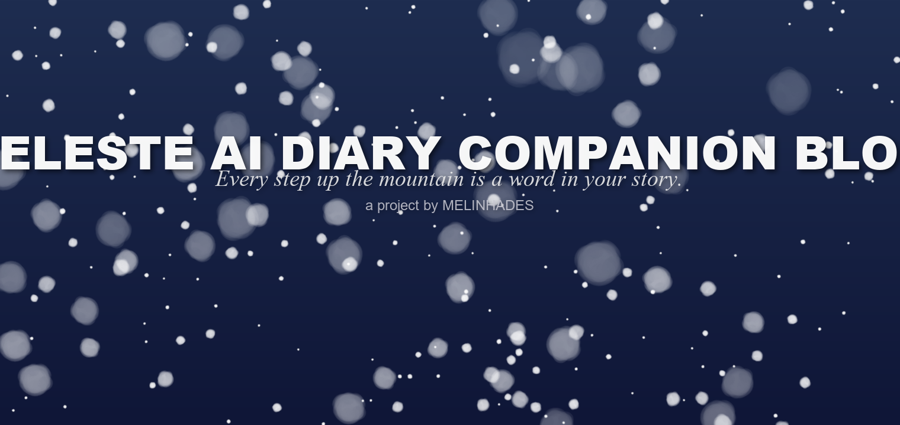</picture>

  

---

# <picture><source media="(prefers-color-scheme: dark)" srcset="../assets/readme/license/l001-dark.webp"></picture>

<picture><source media="(prefers-color-scheme: dark)" srcset="../assets/readme/license/l002-dark.webp"></picture>

> - <picture><source media="(prefers-color-scheme: dark)" srcset="../assets/readme/license/l003-dark.webp"></picture> <a href="../LICENSE"><picture><source media="(prefers-color-scheme: dark)" srcset="../assets/readme/license/l004-dark.webp"></picture></a> <picture><source media="(prefers-color-scheme: dark)" srcset="../assets/readme/license/l005-dark.webp"></picture>
> - <picture><source media="(prefers-color-scheme: dark)" srcset="../assets/readme/license/l006-dark.webp"></picture> <a href="LICENSE.src.md"><picture><source media="(prefers-color-scheme: dark)" srcset="../assets/readme/license/l007-dark.webp"></picture></a> <picture><source media="(prefers-color-scheme: dark)" srcset="../assets/readme/license/l008-dark.webp"></picture>

## <picture><source media="(prefers-color-scheme: dark)" srcset="../assets/readme/license/l009-dark.webp">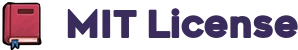</picture>

<picture><source media="(prefers-color-scheme: dark)" srcset="../assets/readme/license/l010-dark.webp">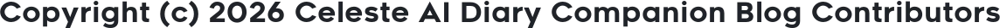</picture>

<picture><source media="(prefers-color-scheme: dark)" srcset="../assets/readme/license/l011-dark.webp">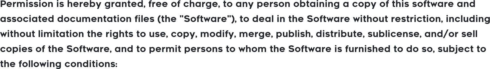</picture>

<picture><source media="(prefers-color-scheme: dark)" srcset="../assets/readme/license/l012-dark.webp">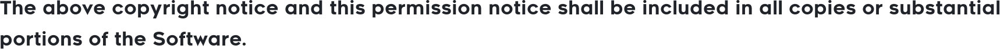</picture>

<picture><source media="(prefers-color-scheme: dark)" srcset="../assets/readme/license/l013-dark.webp">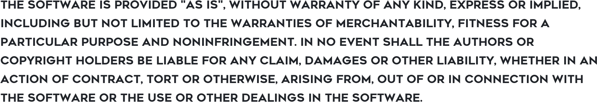</picture>

## <picture><source media="(prefers-color-scheme: dark)" srcset="../assets/readme/license/l014-dark.webp"></picture>

- <a href="https://celestegame.com/"><picture><source media="(prefers-color-scheme: dark)" srcset="../assets/readme/license/l015-dark.webp"></picture></a> <picture><source media="(prefers-color-scheme: dark)" srcset="../assets/readme/license/l016-dark.webp">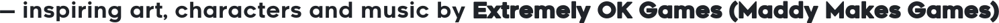</picture>
- <picture><source media="(prefers-color-scheme: dark)" srcset="../assets/readme/license/l017-dark.webp"></picture>
- <a href="https://siliconflow.cn/"><picture><source media="(prefers-color-scheme: dark)" srcset="../assets/readme/license/l018-dark.webp"></picture></a> <picture><source media="(prefers-color-scheme: dark)" srcset="../assets/readme/license/l019-dark.webp">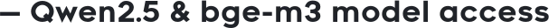</picture>
- <a href="https://baomidou.com/"><picture><source media="(prefers-color-scheme: dark)" srcset="../assets/readme/license/l020-dark.webp"></picture></a> <picture><source media="(prefers-color-scheme: dark)" srcset="../assets/readme/license/l021-dark.webp">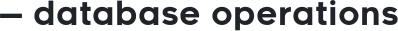</picture>
- <a href="https://spring.io/projects/spring-boot"><picture><source media="(prefers-color-scheme: dark)" srcset="../assets/readme/license/l022-dark.webp"></picture></a> <picture><source media="(prefers-color-scheme: dark)" srcset="../assets/readme/license/l023-dark.webp">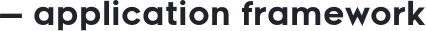</picture>
- <picture><source media="(prefers-color-scheme: dark)" srcset="../assets/readme/license/l024-dark.webp">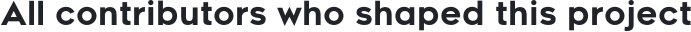</picture>

## <picture><source media="(prefers-color-scheme: dark)" srcset="../assets/readme/license/l025-dark.webp"></picture>

<table>
<tr><th align="left"><picture><source media="(prefers-color-scheme: dark)" srcset="../assets/readme/license/l026-dark.webp">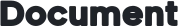</picture></th><th align="left"><picture><source media="(prefers-color-scheme: dark)" srcset="../assets/readme/license/l027-dark.webp"></picture></th></tr>
<tr><td align="left"><a href="../LICENSE"><picture><source media="(prefers-color-scheme: dark)" srcset="../assets/readme/license/l028-dark.webp"></picture></a></td><td align="left"><picture><source media="(prefers-color-scheme: dark)" srcset="../assets/readme/license/l029-dark.webp">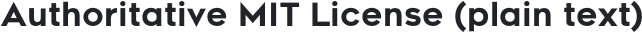</picture></td></tr>
<tr><td align="left"><a href="../CONTRIBUTING.md"><picture><source media="(prefers-color-scheme: dark)" srcset="../assets/readme/license/l030-dark.webp"></picture></a></td><td align="left"><picture><source media="(prefers-color-scheme: dark)" srcset="../assets/readme/license/l031-dark.webp">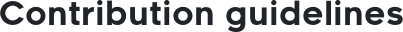</picture></td></tr>
<tr><td align="left"><a href="../README.md"><picture><source media="(prefers-color-scheme: dark)" srcset="../assets/readme/license/l032-dark.webp"></picture></a></td><td align="left"><picture><source media="(prefers-color-scheme: dark)" srcset="../assets/readme/license/l033-dark.webp">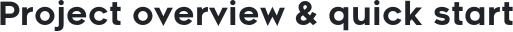</picture></td></tr>
<tr><td align="left"><a href="../TROUBLESHOOTING.md"><picture><source media="(prefers-color-scheme: dark)" srcset="../assets/readme/license/l034-dark.webp"></picture></a></td><td align="left"><picture><source media="(prefers-color-scheme: dark)" srcset="../assets/readme/license/l035-dark.webp"></picture></td></tr>
</table>

---

