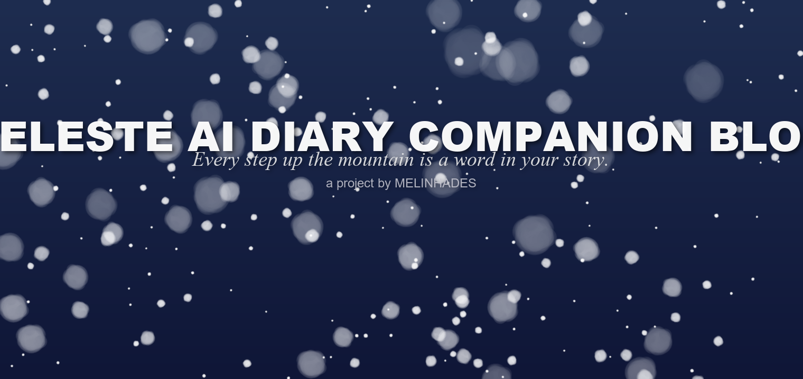
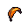

  

<picture><source media="(prefers-color-scheme: dark)" srcset="../assets/readme/header-banner-dark.png"></picture>

  

---

#  License

This project is licensed under the **MIT License**.

> - The **authoritative text** is the plain-text [LICENSE](../LICENSE) at the repository root — GitHub renders that file in its license viewer, where markdown and images don't work, so it has to stay plain
> - This page is the same text set in the site's fonts (Renogare + CelesteZH); edit [LICENSE.src.md](LICENSE.src.md) and run `python tools/build_readme_fonts.py license` to regenerate

##  MIT License

Copyright (c) 2026 Celeste AI Diary Companion Blog Contributors

Permission is hereby granted, free of charge, to any person obtaining a copy
of this software and associated documentation files (the "Software"), to deal
in the Software without restriction, including without limitation the rights
to use, copy, modify, merge, publish, distribute, sublicense, and/or sell
copies of the Software, and to permit persons to whom the Software is
furnished to do so, subject to the following conditions:

The above copyright notice and this permission notice shall be included in all
copies or substantial portions of the Software.

THE SOFTWARE IS PROVIDED "AS IS", WITHOUT WARRANTY OF ANY KIND, EXPRESS OR
IMPLIED, INCLUDING BUT NOT LIMITED TO THE WARRANTIES OF MERCHANTABILITY,
FITNESS FOR A PARTICULAR PURPOSE AND NONINFRINGEMENT. IN NO EVENT SHALL THE
AUTHORS OR COPYRIGHT HOLDERS BE LIABLE FOR ANY CLAIM, DAMAGES OR OTHER
LIABILITY, WHETHER IN AN ACTION OF CONTRACT, TORT OR OTHERWISE, ARISING FROM,
OUT OF OR IN CONNECTION WITH THE SOFTWARE OR THE USE OR OTHER DEALINGS IN THE
SOFTWARE.

##  Acknowledgments

- [Celeste](https://celestegame.com/) — inspiring art, characters and music by **Extremely OK Games (Maddy Makes Games)**
- Renogare + CelesteZH — the pixel typefaces this project's interface and documentation are set in
- [SiliconFlow](https://siliconflow.cn/) — Qwen2.5 & bge-m3 model access
- [MyBatis-Plus](https://baomidou.com/) — database operations
- [Spring Boot](https://spring.io/projects/spring-boot) — application framework
- All contributors who shaped this project

##  Related Documents

| Document | Purpose |
|----------|---------|
| [LICENSE](../LICENSE) | Authoritative MIT License (plain text) |
| [CONTRIBUTING.md](../CONTRIBUTING.md) | Contribution guidelines |
| [README.md](../README.md) | Project overview & quick start |
| [TROUBLESHOOTING.md](../TROUBLESHOOTING.md) | Exhaustive troubleshooting |

---

