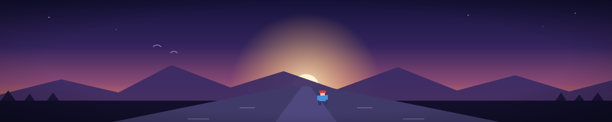

 

 

 

把游戏里那座山，搬进自己的生活里。

## 一个人，一座山

我不太会介绍自己，所以换个说法。

游戏里那座山，我早就爬上去了。真到山顶反而有点空——
后来才想明白：游戏里那座山只是个比喻，我自己的那一座，还没到头。

所以这里写的不是履历，是一张还没画完的地图。

### ⛰️ 我自己的那座山

它铺在清晨的跑道上。

天没亮就出门。鞋带系好，人还犯着困，腿已经先动了。
十公里跑完，天刚好亮起来——那是我一天里最安静的一段时间。

风大的日子出门，不想动的日子也出门。说不上什么了不起，
只是天亮之前那段路，我一向习惯自己走完。

跑久了，记住的其实不是配速，是些很小的事：
路灯一盏一盏灭下去的顺序；冬天呼出来的白气；
还有最后两公里，脑子里那些乱七八糟的念头终于安静下来。

这种事没法给别人看。没有截图，没有点赞，
只剩每天那个「要不要出门」的瞬间——而我通常在出门之后，才决定要出门。

### 🕹️ 为什么是 Celeste

一开始只是觉得它好看。像素画，雪，风，一座看起来很孤独的山。

后来发现它讲的是别的事：一个跟自己过不去的女孩，一路摔一路爬，
爬到山顶才明白——真正难爬的不是山，是自己。
她心里有个一直在说「你不行」的自己。这个我懂。可能很多人都懂。

最打动我的地方是：那个「另一个自己」最后不是被打败的。
她是被接住的。赶不走的那一部分，可以带着一起往上爬。

所以它教我的不是「坚持就会赢」，而是：**摔下去没什么，按一次「再来」就行。**
一关可以死一千次。第一千零一次，还是能过。

她的操作键一共就这几个：<kbd>←</kbd><kbd>→</kbd><kbd>↓</kbd><kbd>Space</kbd><kbd>Z</kbd>。
难的从来不是按键，是愿意再按一万次。

### 🍓 我给自己找的草莓

山上有草莓。它们不会帮你过关，只是藏在最难走的岔路上，
想要就得绕远、就得再死几次。**本来完全可以不要。**

我也有这么一颗：每天早上那十公里。
没人要求，也不加分，纯粹是自己给自己加的难度。

慢慢才明白——把人拉开的往往不是必须做的事，
是那些「不做也没关系」的事，你还愿不愿意做。

还有金色的草莓：一整章从头到尾，一次都不能死。
那种事我暂时还做不到。先记在这儿。

### 🌟 山上教我的事

游戏里她一直在对自己说：**You can do this.** 后来这句话被我用在自己的路上了。

几句一直记着的话：

> 摔下去不是失败，停下来才是。
>
> 山不会因为你累了就变矮，但你会变强。
>
> 最难的不是登顶，是明天还愿意出门。
>
> 屏幕里那个「再来」，是这世上最温柔的一个按钮。
>
> 别急着到山顶，路上的草莓比山顶更多。

### 📖 正在啃的东西

大三，软件工程。课本之外，这几样是自己在啃的——

| 在啃 | 怎么啃 |
| :--- | :--- |
| 机器人学习 | 只用 NumPy，从零写，不调库 |
| 前端 | 不靠框架，先把原生写明白 |
| 大模型应用 | 从一个日记本开始，边做边学 |
| 跑步 | 每天十公里，没有捷径可抄 |

进度条大概是：会一点，但都还很浅。
不过没关系——游戏里也是从第一关开始的。

### 🕐 我的一天

把一天画成地图，大概是这样：

| 时段 | 在做什么 |
| :--- | :--- |
| 天亮前 | 十公里。跑完，一天才算真正开始 |
| 白天 | 上课，写作业，偶尔走神再把自己拽回来 |
| 晚上 | 啃书、写代码。经常在同一个地方卡很久 |
| 深夜 | 打两关 Celeste，或者写点没人看的东西 |

没什么稀奇的，就是重复。

但游戏早就教过我：存档点不是用来休息的，
是用来摔下去之后，还来得及回去的。

### 🌱 关于我

| | |
| :--- | :--- |
| 现在 | 在太原理工大学读软件工程，现在大三 |
| 每天 | 天亮之前，先把一段路跑完 |
| 一直 | 喜欢 Celeste，喜欢到给它写了点东西 |

**可以跟我聊这些**

像素画怎么画出边缘。Celeste 的关卡为什么让人想再试一次。
怎么不靠框架把前端从零写出来。还有跑步——配速、路线、天亮前那半小时。

**坚持的另一种写法**

跑步没法截图，那就放这个吧。

### 🧗 山脚下的东西

爬山路上顺手做的一些东西。不是重点，但都认真做了。

| 项目 | 一句话 |
| :--- | :--- |
| [Celeste-AI-Diary-Companion-Blog](https://github.com/melinhades/Celeste-AI-Diary-Companion-Blog) | 给 Celeste 做的一个小世界。 |
| [robolings](https://github.com/melinhades/robolings) | 机器人学习的小练习，只用 NumPy。 |
| [Weave](https://github.com/melinhades/Weave) | 一个服务研发平台。 |
| [CelesteTAS](https://github.com/melinhades/CelesteTAS) | 一些 TAS 录像。 |

### 🧭 还没爬完的坡

给自己留的一张清单（点开看）

- 把机器人学习的练习整理成一套能跑通的笔记
- 不用框架，把一座完整的应用从零搭出来
- 把手里的日记本做扎实，而不是做多
- 让十公里变成像刷牙一样的事，然后一直保持下去

### 📮 给同路的你

如果你也在爬自己的那座山——
不管它叫保研、叫秋招、叫一个改不完的 bug，
还是叫一件每天都要重新下决心的事——

把游戏里那句最普通的话，原样送给你：

**You can do this.**

不是客套。是一千次摔下去之后，亲眼见过：
那个「再来」的按钮，真的还在原地等你。

路过的话，打个招呼。邮箱就在下面——山脚下一直有人。

*「山就在那里。爬就是了。」*

联系我：<a href="mailto:jfy2846484252@outlook.com">jfy2846484252@outlook.com</a>

<!--
贪吃蛇贡献图：等 .github/workflows/snake.yml 第一次跑成功再启用。
首次跑之前这个链是 404，会显示破图，所以先注释着。
想启用就把下面这段的注释去掉。

  <picture>
    <source media="(prefers-color-scheme: dark)" srcset="https://raw.githubusercontent.com/melinhades/melinhades/output/snake-dark.svg" />
    <source media="(prefers-color-scheme: light)" srcset="https://raw.githubusercontent.com/melinhades/melinhades/output/snake.svg" />
    
  </picture>

-->
