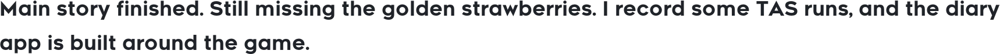
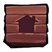
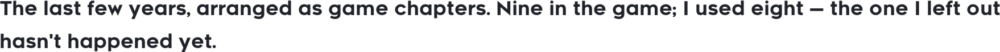
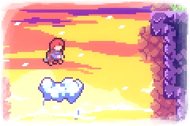
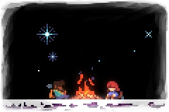
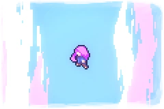
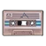
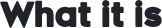

  
     
  
   
  
  
  
    
  
  <picture><source media="(prefers-color-scheme: dark)" srcset="./assets/texts/now-dark.webp"></picture>
    
  <a href="#about"><picture><source media="(prefers-color-scheme: dark)" srcset="./assets/texts/nav-about-dark.webp"></picture></a>&nbsp;<picture><source media="(prefers-color-scheme: dark)" srcset="./assets/texts/nav-sep-dark.webp"></picture>&nbsp;<a href="#stack"><picture><source media="(prefers-color-scheme: dark)" srcset="./assets/texts/nav-stack-dark.webp"></picture></a>&nbsp;<picture><source media="(prefers-color-scheme: dark)" srcset="./assets/texts/nav-sep-dark.webp"></picture>&nbsp;<a href="#chapters"><picture><source media="(prefers-color-scheme: dark)" srcset="./assets/texts/nav-chapters-dark.webp"></picture></a>&nbsp;<picture><source media="(prefers-color-scheme: dark)" srcset="./assets/texts/nav-sep-dark.webp"></picture>&nbsp;<a href="#projects"><picture><source media="(prefers-color-scheme: dark)" srcset="./assets/texts/nav-projects-dark.webp"></picture></a>&nbsp;<picture><source media="(prefers-color-scheme: dark)" srcset="./assets/texts/nav-sep-dark.webp"></picture>&nbsp;<a href="#letters"><picture><source media="(prefers-color-scheme: dark)" srcset="./assets/texts/nav-say-hi-dark.webp"></picture></a>

## <picture><source media="(prefers-color-scheme: dark)" srcset="./assets/headings/about-dark.webp"></picture>

<picture><source media="(prefers-color-scheme: dark)" srcset="./assets/texts/about-1-dark.webp"></picture>

<picture><source media="(prefers-color-scheme: dark)" srcset="./assets/texts/about-2-dark.webp"></picture>

  

  <picture>
    <source media="(prefers-color-scheme: dark)" srcset="./assets/divider-dark.webp" />
    <source media="(prefers-color-scheme: light)" srcset="./assets/divider-light.webp" />
    
  </picture>

### <picture><source media="(prefers-color-scheme: dark)" srcset="./assets/icons/reflection-dark.webp"></picture> <picture><source media="(prefers-color-scheme: dark)" srcset="./assets/headings/celeste-dark.webp"></picture>

<picture><source media="(prefers-color-scheme: dark)" srcset="./assets/texts/celeste-1-dark.webp"></picture>

  <picture>
    <source media="(prefers-color-scheme: dark)" srcset="./assets/divider-dark.webp" />
    <source media="(prefers-color-scheme: light)" srcset="./assets/divider-light.webp" />
    
  </picture>

### <picture><source media="(prefers-color-scheme: dark)" srcset="./assets/icons/core-dark.webp"></picture> <picture><source media="(prefers-color-scheme: dark)" srcset="./assets/headings/stack-dark.webp"></picture>

<table>
<tr><td><picture><source media="(prefers-color-scheme: dark)" srcset="./assets/texts/st-l1-dark.webp"></picture></td><td><picture><source media="(prefers-color-scheme: dark)" srcset="./assets/texts/st-v1-dark.webp"></picture></td></tr>
<tr><td><picture><source media="(prefers-color-scheme: dark)" srcset="./assets/texts/st-l2-dark.webp"></picture></td><td><picture><source media="(prefers-color-scheme: dark)" srcset="./assets/texts/st-v2-dark.webp"></picture></td></tr>
<tr><td><picture><source media="(prefers-color-scheme: dark)" srcset="./assets/texts/st-l3-dark.webp"></picture></td><td><picture><source media="(prefers-color-scheme: dark)" srcset="./assets/texts/st-v3-dark.webp"></picture></td></tr>
<tr><td><picture><source media="(prefers-color-scheme: dark)" srcset="./assets/texts/st-l4-dark.webp"></picture></td><td><picture><source media="(prefers-color-scheme: dark)" srcset="./assets/texts/st-v4-dark.webp"></picture></td></tr>
<tr><td><picture><source media="(prefers-color-scheme: dark)" srcset="./assets/texts/st-l5-dark.webp"></picture></td><td><picture><source media="(prefers-color-scheme: dark)" srcset="./assets/texts/st-v5-dark.webp"></picture></td></tr>
<tr><td><picture><source media="(prefers-color-scheme: dark)" srcset="./assets/texts/st-l6-dark.webp"></picture></td><td><picture><source media="(prefers-color-scheme: dark)" srcset="./assets/texts/st-v6-dark.webp"></picture></td></tr>
</table>

<picture><source media="(prefers-color-scheme: dark)" srcset="./assets/texts/stack-note-dark.webp"></picture>

  <picture>
    <source media="(prefers-color-scheme: dark)" srcset="./assets/divider-dark.webp" />
    <source media="(prefers-color-scheme: light)" srcset="./assets/divider-light.webp" />
    
  </picture>

### <picture><source media="(prefers-color-scheme: dark)" srcset="./assets/icons/intro-dark.webp"></picture> <picture><source media="(prefers-color-scheme: dark)" srcset="./assets/headings/how-i-got-here-dark.webp"></picture>

<picture><source media="(prefers-color-scheme: dark)" srcset="./assets/texts/chapters-intro-dark.webp"></picture>

  

<table>
<tr><td></td><td><picture><source media="(prefers-color-scheme: dark)" srcset="./assets/texts/ch-name-1-dark.webp"></picture></td><td><picture><source media="(prefers-color-scheme: dark)" srcset="./assets/texts/ch-desc-1-dark.webp"></picture></td></tr>
<tr><td></td><td><picture><source media="(prefers-color-scheme: dark)" srcset="./assets/texts/ch-name-2-dark.webp"></picture></td><td><picture><source media="(prefers-color-scheme: dark)" srcset="./assets/texts/ch-desc-2-dark.webp"></picture></td></tr>
<tr><td></td><td><picture><source media="(prefers-color-scheme: dark)" srcset="./assets/texts/ch-name-3-dark.webp"></picture></td><td><picture><source media="(prefers-color-scheme: dark)" srcset="./assets/texts/ch-desc-3-dark.webp"></picture></td></tr>
<tr><td></td><td><picture><source media="(prefers-color-scheme: dark)" srcset="./assets/texts/ch-name-4-dark.webp"></picture></td><td><picture><source media="(prefers-color-scheme: dark)" srcset="./assets/texts/ch-desc-4-dark.webp"></picture></td></tr>
<tr><td></td><td><picture><source media="(prefers-color-scheme: dark)" srcset="./assets/texts/ch-name-5-dark.webp"></picture></td><td><picture><source media="(prefers-color-scheme: dark)" srcset="./assets/texts/ch-desc-5-dark.webp"></picture></td></tr>
<tr><td></td><td><picture><source media="(prefers-color-scheme: dark)" srcset="./assets/texts/ch-name-6-dark.webp"></picture></td><td><picture><source media="(prefers-color-scheme: dark)" srcset="./assets/texts/ch-desc-6-dark.webp"></picture></td></tr>
<tr><td></td><td><picture><source media="(prefers-color-scheme: dark)" srcset="./assets/texts/ch-name-7-dark.webp"></picture></td><td><picture><source media="(prefers-color-scheme: dark)" srcset="./assets/texts/ch-desc-7-dark.webp"></picture></td></tr>
<tr><td></td><td><picture><source media="(prefers-color-scheme: dark)" srcset="./assets/texts/ch-name-8-dark.webp"></picture></td><td><picture><source media="(prefers-color-scheme: dark)" srcset="./assets/texts/ch-desc-8-dark.webp"></picture></td></tr>
</table>

  <picture>
    <source media="(prefers-color-scheme: dark)" srcset="./assets/divider-dark.webp" />
    <source media="(prefers-color-scheme: light)" srcset="./assets/divider-light.webp" />
    
  </picture>

### <picture><source media="(prefers-color-scheme: dark)" srcset="./assets/icons/cassette-dark.webp"></picture> <picture><source media="(prefers-color-scheme: dark)" srcset="./assets/headings/projects-dark.webp"></picture>

<picture><source media="(prefers-color-scheme: dark)" srcset="./assets/texts/projects-intro-dark.webp"></picture>

<table>
<tr><th><picture><source media="(prefers-color-scheme: dark)" srcset="./assets/texts/proj-h1-dark.webp"></picture></th><th><picture><source media="(prefers-color-scheme: dark)" srcset="./assets/texts/proj-h2-dark.webp"></picture></th><th><picture><source media="(prefers-color-scheme: dark)" srcset="./assets/texts/proj-h3-dark.webp"></picture></th></tr>
<tr><td><a href="https://github.com/melinhades/Celeste-AI-Diary-Companion-Blog"><picture><source media="(prefers-color-scheme: dark)" srcset="./assets/texts/proj-n1-dark.webp"></picture></a></td><td><picture><source media="(prefers-color-scheme: dark)" srcset="./assets/texts/proj-d1-dark.webp"></picture></td><td><picture><source media="(prefers-color-scheme: dark)" srcset="./assets/texts/proj-s1-dark.webp"></picture></td></tr>
<tr><td><a href="https://github.com/melinhades/java-ai-langchain4j"><picture><source media="(prefers-color-scheme: dark)" srcset="./assets/texts/proj-n2-dark.webp"></picture></a></td><td><picture><source media="(prefers-color-scheme: dark)" srcset="./assets/texts/proj-d2-dark.webp"></picture></td><td><picture><source media="(prefers-color-scheme: dark)" srcset="./assets/texts/proj-s2-dark.webp"></picture></td></tr>
</table>

  <picture><source media="(prefers-color-scheme: dark)" srcset="./assets/texts/contrib-sub-dark.webp"></picture>
   
  

  <picture>
    <source media="(prefers-color-scheme: dark)" srcset="./assets/divider-dark.webp" />
    <source media="(prefers-color-scheme: light)" srcset="./assets/divider-light.webp" />
    
  </picture>

### <picture><source media="(prefers-color-scheme: dark)" srcset="./assets/icons/checkpoint-dark.webp"></picture> <picture><source media="(prefers-color-scheme: dark)" srcset="./assets/headings/a-day-dark.webp"></picture>

<picture><source media="(prefers-color-scheme: dark)" srcset="./assets/texts/day-summary-dark.webp"></picture>

<table>
<tr><th><picture><source media="(prefers-color-scheme: dark)" srcset="./assets/texts/day-h1-dark.webp"></picture></th><th><picture><source media="(prefers-color-scheme: dark)" srcset="./assets/texts/day-h2-dark.webp"></picture></th></tr>
<tr><td><picture><source media="(prefers-color-scheme: dark)" srcset="./assets/texts/day-t1-dark.webp"></picture></td><td><picture><source media="(prefers-color-scheme: dark)" srcset="./assets/texts/day-w1-dark.webp"></picture></td></tr>
<tr><td><picture><source media="(prefers-color-scheme: dark)" srcset="./assets/texts/day-t2-dark.webp"></picture></td><td><picture><source media="(prefers-color-scheme: dark)" srcset="./assets/texts/day-w2-dark.webp"></picture></td></tr>
<tr><td><picture><source media="(prefers-color-scheme: dark)" srcset="./assets/texts/day-t3-dark.webp"></picture></td><td><picture><source media="(prefers-color-scheme: dark)" srcset="./assets/texts/day-w3-dark.webp"></picture></td></tr>
<tr><td><picture><source media="(prefers-color-scheme: dark)" srcset="./assets/texts/day-t4-dark.webp"></picture></td><td><picture><source media="(prefers-color-scheme: dark)" srcset="./assets/texts/day-w4-dark.webp"></picture></td></tr>
</table>

  <picture>
    <source media="(prefers-color-scheme: dark)" srcset="./assets/divider-dark.webp" />
    <source media="(prefers-color-scheme: light)" srcset="./assets/divider-light.webp" />
    
  </picture>

### <picture><source media="(prefers-color-scheme: dark)" srcset="./assets/icons/farewell-dark.webp"></picture> <picture><source media="(prefers-color-scheme: dark)" srcset="./assets/headings/whats-next-dark.webp"></picture>

<picture><source media="(prefers-color-scheme: dark)" srcset="./assets/texts/next-summary-dark.webp"></picture>

- <picture><source media="(prefers-color-scheme: dark)" srcset="./assets/texts/next-1-dark.webp"></picture>
- <picture><source media="(prefers-color-scheme: dark)" srcset="./assets/texts/next-2-dark.webp"></picture>
- <picture><source media="(prefers-color-scheme: dark)" srcset="./assets/texts/next-3-dark.webp"></picture>

  <picture>
    <source media="(prefers-color-scheme: dark)" srcset="./assets/divider-dark.webp" />
    <source media="(prefers-color-scheme: light)" srcset="./assets/divider-light.webp" />
    
  </picture>

### <picture><source media="(prefers-color-scheme: dark)" srcset="./assets/icons/heart-dark.webp"></picture> <picture><source media="(prefers-color-scheme: dark)" srcset="./assets/headings/say-hi-dark.webp"></picture>

  

<picture><source media="(prefers-color-scheme: dark)" srcset="./assets/texts/sayhi-1-dark.webp"></picture>

 

<picture><source media="(prefers-color-scheme: dark)" srcset="./assets/texts/contact-label-dark.webp"></picture><a href="mailto:jfy2846484252@outlook.com"><picture><source media="(prefers-color-scheme: dark)" srcset="./assets/texts/contact-mail-dark.webp"></picture></a><picture><source media="(prefers-color-scheme: dark)" srcset="./assets/texts/contact-sep-dark.webp"></picture><a href="#top"><picture><source media="(prefers-color-scheme: dark)" srcset="./assets/texts/contact-top-dark.webp"></picture></a>

 

<picture><source media="(prefers-color-scheme: dark)" srcset="./assets/texts/cr-1-dark.webp"></picture><a href="https://www.celestegame.com/"><picture><source media="(prefers-color-scheme: dark)" srcset="./assets/texts/cr-2-dark.webp"></picture></a><picture><source media="(prefers-color-scheme: dark)" srcset="./assets/texts/cr-3-dark.webp"></picture>

<!--
Contribution snake: enable once .github/workflows/snake.yml has run successfully.
Before the first run the links 404 and show broken images, which is why this stays
commented out. Remove the comment markers below to turn it on.

  <picture>
    <source media="(prefers-color-scheme: dark)" srcset="https://raw.githubusercontent.com/melinhades/melinhades/output/snake-dark.svg" />
    <source media="(prefers-color-scheme: light)" srcset="https://raw.githubusercontent.com/melinhades/melinhades/output/snake.svg" />
    
  </picture>

-->
